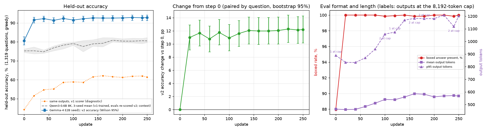
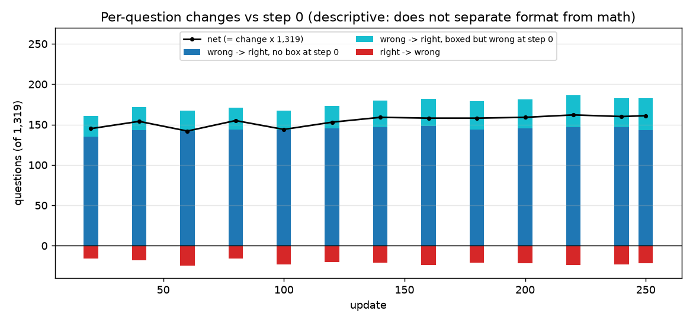
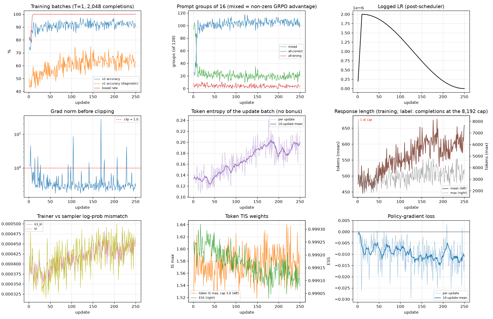
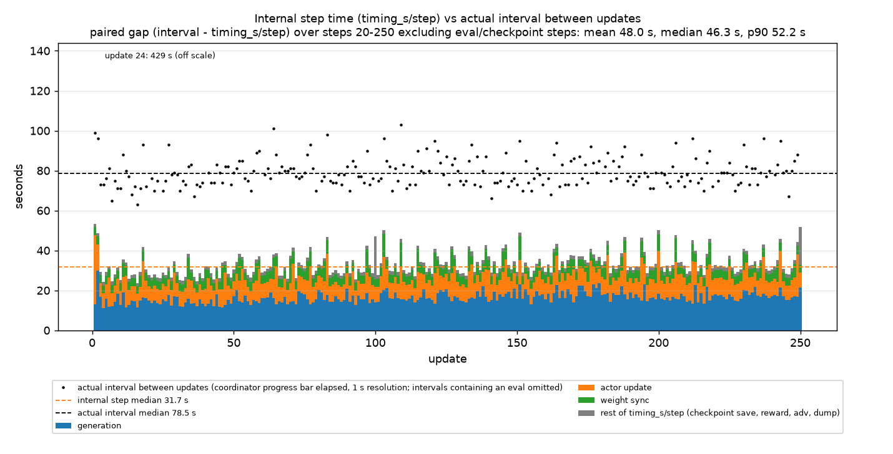

# Gemma-4 E2B on GSM8K (colocated, 8K, no length penalty): seed-1 results

**Seed 1 completed all 250 updates (fixed endpoint). At step 250, held-out v2 accuracy is 92.80%, against 80.59% at step 0: +12.21 pp, paired 95% CI [+10.16, +14.25].** The improvement is strongly associated with output-format compliance: the boxed rate went from 87.95% to 100%. The math-ability gain has not been quantified separately.

The run was stable: no non-finite values, and trainer–sampler `k3_kl` stayed at or below 4.8e-4. Entropy and output length rose slowly and leveled off as the LR decayed. Seeds 2/3 are running with the unchanged recipe; they were launched after the logging fix passed its acceptance run (§9).

Recipe and decisions: [GSM8K_8K_PLAN.md](GSM8K_8K_PLAN.md) §1 and §8. Evidence: [`gsm8k_8k/seed1/`](gsm8k_8k/seed1/). The figures and tables are generated by [`gemma4_gsm8k_report.py`](gemma4_gsm8k_report.py) from the run's log and dumps.

## 1. Run identity

| Item | Value |
|---|---|
| Run | `gemma4_e2b_gsm8k8k_16n64g_s250_seed1_1024_0157`, `g4run_gsm8k.sh SEED1` |
| Time | Launched 2026-10-24T01:57:34Z; finished 07:46Z (5.82 h launch-to-finish); driver exit code 0 |
| Model / start | `google/gemma-4-E2B-it` original weights (safetensors sha256 `2db5482b…`); no prior RL |
| Topology | 16 × 4 GB200 = 64 GPUs, colocated, rollout TP 1 |
| Recipe | `gsm8k_8k_v1` transfer (plan §1): 128 × 16, single-forward REINFORCE + token TIS 3.0, AdamW 2e-6, warmup 10 + cosine to 0 at 250, T=1, 8,192-token cap, no length penalty |
| Reward | Scorer v2 [`boxed_math_reward_v2.py`](../my_scripts_GKE_gsm8k/boxed_math_reward_v2.py) (`933abb3e…`; imports frozen v1 `a743cf71…`); v1 accuracy logged as `acc_v1` |
| Data | Handoff GSM8K train 7,473 (`42e2b6d1…`) / test 1,319 (`0b17cc44…`); training prompt sets match Qwen seed 1's archived order |
| Code | Launcher sha256 `541a8b38…` (commit `62d369e`); run launcher `c2a0c7f4…`; verl pin `ace775e8` |
| Contract checks | Preflight PASS; 58/58 runtime-config asserts ([check](gsm8k_8k/seed1/runtime_config_check.txt)); RoPE guard PASS on 64 ranks with exit code 0 ([check](gsm8k_8k/seed1/guard_check.txt)); `Total steps: 250, num_warmup_steps: 10` |
| Checkpoints | Only steps 100 and 250 saved (19.2 s and 16.4 s, 56 GiB each); 50/150/200 skipped by the allowlist hook ([log](gsm8k_8k/seed1/ckpt_steps_log.txt)). Restore not tested |

## 2. Held-out accuracy

How to read the table:
- Eval covers all 1,319 GSM8K test questions, greedy, with the 8,192-token cap.
- v2 is the training scorer. v1 is the frozen Meta scorer applied to the same outputs, shown as a diagnostic.
- Change and CI are paired by question against the run's own step 0, using 10,000 bootstrap resamples of questions.
- The last column counts outputs that reached the 8,192-token cap.

| Step | v2 acc (Wilson 95%) | v1 acc | Boxed | Change vs step 0 (pp) [95% CI] | Wrong→right (no box / boxed wrong at step 0) | Right→wrong | Output tokens mean / p95 | At cap |
|---:|---|---:|---:|---|---|---:|---|---:|
| 0 | 80.59 [78.37, 82.64] | 44.28 | 87.95 | — | — | — | 464 / 890 | 1 |
| 20 | 91.58 [89.96, 92.96] | 51.63 | 100.00 | +10.99 [+9.10, +12.89] | 161 (135 / 26) | 16 | 460 / 834 | 0 |
| 40 | 92.27 [90.70, 93.59] | 54.74 | 100.00 | +11.68 [+9.70, +13.65] | 172 (143 / 29) | 18 | 462 / 833 | 0 |
| 60 | 91.36 [89.72, 92.76] | 55.19 | 100.00 | +10.77 [+8.79, +12.74] | 167 (142 / 25) | 25 | 484 / 870 | 0 |
| 80 | 92.34 [90.78, 93.66] | 58.68 | 100.00 | +11.75 [+9.86, +13.72] | 171 (144 / 27) | 16 | 510 / 939 | 0 |
| 100 | 91.51 [89.88, 92.90] | 58.91 | 99.85 | +10.92 [+8.95, +12.96] | 167 (143 / 24) | 23 | 540 / 1,058 | 2 |
| 120 | 92.19 [90.62, 93.52] | 58.68 | 99.92 | +11.60 [+9.63, +13.57] | 173 (145 / 28) | 20 | 538 / 1,074 | 1 |
| 140 | 92.65 [91.11, 93.93] | 61.56 | 100.00 | +12.05 [+10.01, +14.10] | 180 (147 / 33) | 21 | 560 / 1,169 | 0 |
| 160 | 92.57 [91.03, 93.87] | 62.17 | 99.85 | +11.98 [+9.93, +14.03] | 182 (148 / 34) | 24 | 586 / 1,183 | 2 |
| 180 | 92.57 [91.03, 93.87] | 61.64 | 99.85 | +11.98 [+10.01, +14.03] | 179 (144 / 35) | 21 | 581 / 1,181 | 2 |
| 200 | 92.65 [91.11, 93.93] | 61.26 | 100.00 | +12.05 [+10.01, +14.10] | 181 (145 / 36) | 22 | 561 / 1,181 | 0 |
| 220 | 92.87 [91.36, 94.14] | 61.87 | 100.00 | +12.28 [+10.24, +14.40] | 186 (147 / 39) | 24 | 568 / 1,209 | 0 |
| 240 | 92.72 [91.19, 94.00] | 62.02 | 99.85 | +12.13 [+10.08, +14.18] | 183 (147 / 36) | 23 | 571 / 1,118 | 2 |
| **250** | **92.80 [91.27, 94.07]** | 61.41 | 100.00 | **+12.21 [+10.16, +14.25]** | 183 (143 / 40) | 22 | 567 / 1,202 | 0 |

- **Most of the change came by step 20 (+10.99 pp).** From step 20 on, accuracy stays in a 91.36–92.87% band. The later checkpoints (+11.98 to +12.28 pp at steps 140–250) sit slightly above the earlier ones (+10.77 to +11.75 pp at 20–100), but the per-checkpoint intervals overlap; this difference was not tested.
- **Run-to-run variation of greedy eval.** The integration smoke's step-0 eval differed from this run's by 3 answers (0.23 pp). Differences of that size between checkpoints are within the eval's run-to-run variation.
- **Context, not a target: the Qwen3-0.6B reference.** In the figure it is the gray curve: the 3-seed mean of runs trained with v1, with their evals re-scored under v2 (plan §8.2). Under v2 it goes from 75.26% to 80.57% (+5.31 pp). Gemma starts at about Qwen's final level and is a different, post-trained model.

## 3. Per-question changes

**Task accuracy improved significantly, and the improvement is strongly associated with output-format compliance. The math-ability gain has not been quantified separately.**

- At step 250, 183 answers went from wrong to right. 143 of them had no `\boxed{}` at step 0, and 40 were boxed but wrong. 22 answers went from right to wrong.
- The 143 split describes the outputs; it does not separate format from math. Whether those step-0 outputs already reached the right number without boxing it has not been checked, so neither "format" nor "math" can be credited from these counts.
- The v1 accuracy of the same outputs rose from 44.28% to 61.41%: the model writes more bare numbers, although v2 scores `\$18` and `18` the same. The cause has not been analyzed.

## 4. Training diagnostics

| Updates | Entropy (mean) | Response tokens (mean) | Train v2 acc | Train v1 acc | Boxed | Mixed / all-correct / all-wrong groups (of 128) |
|---|---:|---:|---:|---:|---:|---|
| 1–20 | 0.133 | 483 | 84.5% | 49.6% | 94.5% | 48.7 / 73.9 / 5.5 |
| 21–40 | 0.129 | 480 | 89.8% | 53.9% | 100% | 22.5 / 100.4 / 5.2 |
| 81–100 | 0.153 | 548 | 91.8% | 60.6% | 100% | 20.4 / 103.9 / 3.8 |
| 161–180 | 0.197 | 609 | 91.9% | 64.1% | 100% | 18.4 / 105.8 / 3.9 |
| 181–200 | 0.185 | 595 | 93.0% | 63.8% | 100% | 18.5 / 106.6 / 3.0 |
| 231–250 | 0.198 | 612 | 92.1% | 63.5% | 100% | 20.4 / 104.1 / 3.6 |

- **Numerics stayed stable.**
  - No non-finite values.
  - `k3_kl` 3.37–4.82e-4; `kl` 3.14–4.99e-4.
  - Token IS max 1.52–1.64, against a cap of 3.0. The token fraction above the cap was at most 3.5e-6, and ESS stayed at or above 0.9990.
- **Grad norm (before clipping).** Median 0.29; 16 of 250 updates were above the clip value of 1.0.
  - The spikes were isolated: 27.9 at update 169, 8.45 at 104, 4.52 at 4, 4.21 at 229, and 1.76–2.18 at 14, 21, 177 and 207.
  - At each spike, the rollout-correction metrics and batch accuracy were normal, and the following updates returned to the usual range of 0.3–1.0.
  - Update 169 had only 13 mixed groups, so its gradient came from very few prompts.
- **Slow drifts.**
  - Entropy (20-update mean) went from 0.133 to about 0.19–0.20; length went from 483 to about 600 tokens.
  - Both rose mostly over updates 40–180 and leveled off as the LR decayed below about 5e-7.
  - Eval output length rose from 464 to 567 tokens mean, and from 890 to 1,202 at p95.
- **Truncation stayed rare.** One training completion out of 512,000 reached the 8,192 cap, at update 2. In eval, 0–2 of 1,319 outputs per checkpoint reached it, and 0 at step 250.
- **Signal density.** After about update 10, the training batches are about 90–93% correct. Only about 18–23 of the 128 prompt groups have mixed correctness and so a non-zero GRPO advantage.

## 5. Timing and cost

Two step times are reported separately; they measure different things.
- The **internal step time** is `timing_s/step`: generation through the rollout dump.
- The **actual interval** is the time between consecutive updates, read from the coordinator's (TaskRunner's) own clock. For seed 1 that is the progress bar's elapsed time, at 1 s resolution.
- Seed 1 predates the explicit coordinator step clock, and file mtimes are not used.

| Seed 1, steps 20–250 excluding eval and checkpoint steps (n = 218, paired) | Median | Mean | p90 |
|---|---:|---:|---:|
| **Internal step time** `timing_s/step` | **31.7 s** | 33.1 s | 41.2 s |
| **Actual interval between updates** (coordinator progress-bar clock) | **78.5 s** | 81.1 s | 90.0 s |
| Paired gap (interval − internal) | 46.3 s | 48.0 s | 52.2 s |

- **Internal components (medians):** generation 16.3 s, actor update 8.1 s, weight sync 4.1 s, dump 1.4 s.
- **Where the gap came from.** It is work outside `timing_s/step`, mostly TensorBoard logging. `TENSORBOARD_DIR` is on the GCS-fuse bucket, where every scalar is an open-append-close that re-uploads the event file (532 ms each, measured; plan §8.6). Update 24 also stalled once, with a 429 s interval.
- **Outside the step timer:** the 13 evals at steps 20–250 took 10–34 s each, about 4.7 min in total. The two checkpoint saves took 19.8 s and 17.0 s.
- **Cost of seed 1.** 5.82 h launch-to-finish × 64 GPUs = 372 GPU-hours, generating 2.86e8 training tokens.
- **The fix was accepted in a run** (plan §8.7, [`gsm8k_8k/perf_validation/`](gsm8k_8k/perf_validation/)).
  - The launcher logs to the console plus verl's file logger (`metrics.jsonl`). A Ray setup hook adds the coordinator's own clock to every record (`wallclock/coordinator_unix`, `wallclock/interval_s`).
  - A 30-update run of the seed-1 configuration, on the 250-step schedule, was compared with seed 1 over updates 3–30 excluding the eval step (n = 27).

  | Updates 3–30 | Internal step time (mean / median / p90) | Actual interval (mean / median / p90) | Paired gap |
  |---|---|---|---|
  | Seed 1 (old launcher) | 29.1 / 28.1 / 34.0 s | 88.6 / 75.0 / 88.0 s | mean 59.5 s, median 46.8 s |
  | Acceptance run (new launcher) | 29.7 / 28.5 / 36.8 s | **29.8 / 28.6 / 36.9 s** | **0.1 / 0.1 / 0.1 s** |

  Seeds 2/3 run with this launcher. Their actual interval is measured by the coordinator clock and will replace the earlier "about 2.5 h per seed" estimate.

## 6. Checkpoints

The hook skipped steps 50, 150 and 200, and saved 100 and 250, each the full state (model, optimizer, extra, dataloader): `/workspace/meta-RL/ckpt/gemma4_e2b_gsm8k8k_16n64g_s250_seed1_1024_0157/global_step_{100,250}`. Restore was not exercised.

## 7. Limits

- One seed. The between-seed spread is unknown, and the question-paired intervals do not include training-seed variation.
- The format and math effects are not separated (§3).
- Seed 1's wall-clock includes the logging overhead (§5). For compute comparisons, use the internal step time, or the interval with the overhead stated. Seeds 2/3 run without it.
- Checkpoint restore has not been tested.

## 8. Evidence

All files are in [`gsm8k_8k/seed1/`](gsm8k_8k/seed1/):

- `seed1_summary.json`: the per-checkpoint eval statistics and the per-update training and timing series used above;
- the four figures;
- `run_check.txt`, from [`gemma4_gsm8k_run_check.py`](gemma4_gsm8k_run_check.py): provenance, checkpoints, every training batch re-scored offline equal to the stored score, and every `actor/rollout_corr/*` tag;
- `runtime_config_check.*`, `guard_check.*` and `preflight.json`;
- `ckpt_steps_log.txt`, `provenance.txt` and `checkpoint_sizes.txt`.

The raw dumps stay on the cluster under `/workspace/meta-RL/logs/gemma4_gsm8k/gemma4_e2b_gsm8k8k_16n64g_s250_seed1_1024_0157/`: 14 eval files × 1,319 rows, and 250 training files × 2,048 rows.

## 9. Seeds 2/3

**Decision (2026-10-24):** run seeds 2 and 3 with the unchanged recipe, precision and batch, after the logging fix passes a step-time acceptance run.
- That run passed (§5, plan §8.7).
- Seed 2 (`gemma4_e2b_gsm8k8k_16n64g_s250_seed2_1024_0847`) started at 08:47Z with the validated launcher, sha256 `e0aafe35…`.
- Seed 3 starts automatically only if seed 2 exits with code 0.
- Both use the same checks and the same report.

A possible analysis that needs no GPU: for the 143 questions without a box at step 0, check whether each step-0 output's final stated number equals the gold. That would estimate the format-only share. It is a heuristic and would be reported as such.
