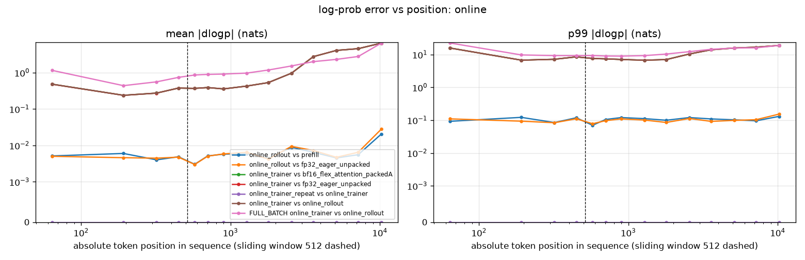
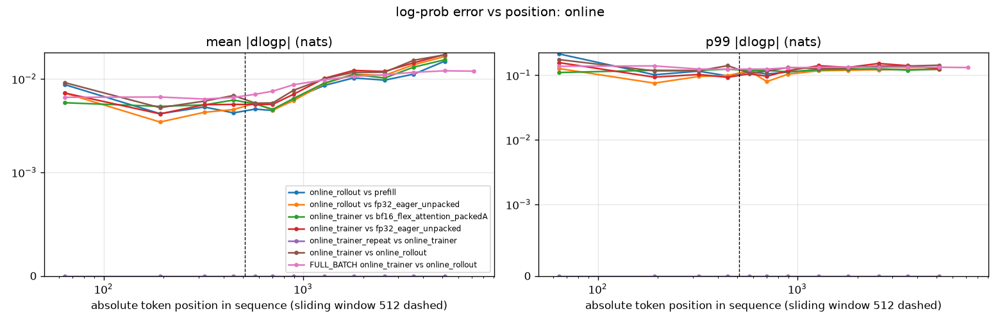

# Gemma-4 E2B: trainer vs sampler log-prob parity (root cause + fix)

**Status: fixed.** Trainer and sampler log-probs now agree to bf16 noise. The accuracy / convergence gate (README §4) is still pending.

The online FSDP trainer computed wrong log-probs on about half of its data-parallel ranks. On those ranks the RoPE frequency buffers were scrambled during FSDP initialization, because transformers registers them in a per-process random order and FSDP1 broadcasts buffers by position. The vLLM rollout was correct all along. [`patch_verl_gemma4_rope_buffers.py`](patch_verl_gemma4_rope_buffers.py) fixes it.

| Step 1, T=1, top-k/top-p off, 4n16g (2,048 sequences) | before | after |
|---|---|---|
| `rollout_corr/k3_kl` | 0.982 | **0.00046** |
| `rollout_corr/kl` | 1.134 | **0.00048** |
| Pearson(p_train, p_rollout) | 0.511 | **0.9992** |
| prob MAE (`training/rollout_probs_diff_mean`) | 0.201 | **0.0033** |
| `training_log_ppl` / `rollout_log_ppl` | 1.103 / 0.201 | **0.2040 / 0.2035** |
| DP ranks with all 128 sequences wrong (per-seq mean \|dlogp\| > 0.5) | 7 of 16 | **0 of 16** |
| per-sequence mean \|dlogp\|, median / p99 / max | 0.014 / 3.75 / 4.48 | **0.0077 / 0.018 / 0.025** |

Production config after the fix (frozen launcher: T=0.8, top-k 50, top-p 0.95; 4 steps):
- `rollout_corr/k3_kl` ≈ 7e-4 (was 1.31–1.40)
- Pearson 0.997 (was 0.41)
- steps 2–4 median 74.0 s (77.7 s before the fix): no obvious step-time regression in this 4-step smoke (§6)

---

## 1. Method

Each rung of the ladder removes one possible cause:

| Comparison | What it isolates |
|---|---|
| HF `sdpa` / `flex_attention` unpacked vs HF `eager` unpacked | attention backend |
| HF packed vs the same backend unpacked | packing, position IDs, masks |
| offline vLLM `prompt_logprobs` vs HF | vLLM vs HF prefill implementation |
| the above vs the online rollout / online trainer values | decode path, KV cache, weight sync, record alignment, trainer engine |

Experimental conditions:

- **Same weights, same token IDs.** [`patch_verl_pin_logprob_fixture.py`](patch_verl_pin_logprob_fixture.py) dumps the step-1 batch right before the first update (env-gated, off by default). The dump contains the prompt/response token IDs exactly as the rollout produced them, the masks, `position_ids`, `rollout_log_probs` (online vLLM), `old_log_probs` (online trainer) and a repeated trainer pass. Offline HF and vLLM load the same checkpoint. Nothing is decoded or re-tokenized.
- **One convention: T=1, `top_k=-1`, `top_p=1.0`.** At these settings vLLM's `processed_logprobs` is the full-vocabulary `log_softmax(logits)`, the same quantity the trainer computes. The harness checks the next-token shift and the response mask against the fixture layout.
- **Packed path is verl's own.** Sequences are concatenated into rows of ≤ 16,384 tokens (`ppo_max_token_len_per_gpu`), `position_ids` restart per sequence, `attention_mask=None`, and verl's `apply_monkey_patch()` is applied. Two orders (A/B) vary neighbours and offsets.
- **Precision matches verl.** bf16 parameters, fp32 buffers, bf16 autocast. fp32 `eager` is the precision reference.
- **Metrics.** Per-token \|dlogp\| mean / p50 / p99 / max, signed mean, prob-MAE and k3. Error is also plotted against absolute token position, with the 512-token sliding window marked.

Harness: [`gemma4_logprob_parity.py`](gemma4_logprob_parity.py) (`select → hf → vllm → report`). Fixtures and per-token results are kept in `gs://xiaotongyang-bucket/meta-rl/GKE_repro/meta-RL/logprob_parity/` (`/workspace/meta-RL/logprob_parity/` in the pods).

The harness refuses to mix results:
- Every stage checks that the fixture is a parity fixture: dumped at step 1, T=1, no top-k/top-p, and sampled from the initial weights (`nt__global_steps` = 0). `--allow_nonparity_fixture` overrides this check.
- `selection.json` and every `hf__*`/`vllm__*` result carry the fixture's sha256 and the selected indices. `report` exits if any result does not match the current fixture and selection, or if its per-sequence lengths are wrong.

Use one `--out` directory per fixture. The before/after results below were produced by the first version of the harness, which lacked these checks, but each fixture had its own directory, so nothing was mixed. Re-running the hardened harness on the post-fix fixture gives:
- the HF and online rows exactly;
- the vLLM rows within run-to-run noise ([`after_fix/summary_rerun_hardened_tool.md`](logprob_parity/after_fix/summary_rerun_hardened_tool.md)).

The refusal cases are exercised in [`after_fix/provenance_negative_tests.txt`](logprob_parity/after_fix/provenance_negative_tests.txt).

---

## 2. Before the fix: only the online trainer disagrees

Fixture `fixture_t1_notrunc_1021_0723`: 16 selected sequences (26,307 response tokens, lengths 386–8,332, including one 8,192-token cap hit) plus full-batch statistics. Full table: [`before_fix/summary.md`](logprob_parity/before_fix/summary.md).

| Rung | A vs B | mean \|dlogp\| | p99 | max |
|---|---|---|---|---|
| noise floor | bf16 eager vs fp32 eager | 0.0071 | 0.121 | 0.71 |
| backend | bf16 sdpa / flex vs bf16 eager (unpacked) | 0.0069 / 0.0067 | 0.122 / 0.121 | 0.86 / 0.74 |
| packing | packed A/B vs unpacked (eager, sdpa, flex) | 0.0042–0.0072 | 0.102–0.125 | ≤ 0.83 |
| prefill | offline vLLM `prompt_logprobs` vs fp32 eager | 0.0059 | 0.103 | 0.41 |
| online rollout | online vLLM vs offline vLLM prefill / fp32 eager | 0.0057 / 0.0059 | 0.110 / 0.100 | 0.66 / 0.47 |
| **online trainer** | online trainer vs fp32 eager / bf16 flex packed | **1.210 / 1.210** | **12.9** | **24.1** |
| trainer repeat | second trainer pass vs first | 0 | 0 | 0 |
| full batch | online trainer vs online rollout (3.63 M tokens) | 1.161 (k3 0.982) | 11.8 | 37.8 |

Every rung agrees to bf16 noise, including the online rollout. The SDPA result alone only showed that the problem is not flex-specific. This ladder rules out the common packing, position-ID and mask path as well, since all backends match unpacked to noise in verl's own packed layout. The online trainer is the only outlier, and it is deterministic (the repeat pass is bitwise identical).



The backend, packing and prefill curves are flat at about 5e-3 across positions, with no step at 512 ([backend](logprob_parity/before_fix/err_vs_pos_backend.png), [packing](logprob_parity/before_fix/err_vs_pos_packing.png), [prefill](logprob_parity/before_fix/err_vs_pos_prefill.png)). The online-trainer error is large from the first response tokens and grows with position.

---

## 3. Localization: the error is per rank

- **Per sequence, the error is bimodal.** 34% of sequences have mean \|dlogp\| < 0.01, while 44% are above 0.5. In the bad sequences the trainer log-prob of the sampled tokens averages −2.85, against −0.27 from the rollout, with Pearson 0.35. Shifting the alignment by ±1 or ±2 tokens does not help (mean \|dlogp\| 2.65–2.67), so this is not an alignment bug.
- **Per DP rank, the error is all or nothing.** After `balance_batch`, each rank owns a contiguous chunk of 128 sequences. On 7 ranks every sequence is wrong (128/128); on the other 9, none are ([`before_fix/fixture_rank_chunks.txt`](logprob_parity/before_fix/fixture_rank_chunks.txt)). A second run gave a different set of 7 bad ranks. Rank 0 was good in both runs.
- **Canary probe.** [`patch_verl_pin_rank_probe.py`](patch_verl_pin_rank_probe.py) makes every rank run the same 256-token sequence and record per-module output checksums plus all buffers. It runs before the first weight sync (`pre_sync`) and at `compute_log_prob` (`fwd`). The ranks split into two groups (canary log-prob sum −975.1 vs −1073.1). They split **already before the first weight sync**, the first diverging module is `language_model.layers.0` (the embeddings are identical), and the only differing buffers are the text RoPE frequencies ([`before_fix/rank_probe_compare.txt`](logprob_parity/before_fix/rank_probe_compare.txt)):

| buffer (sum of entries) | good ranks | bad ranks | fresh HF (fp32) |
|---|---|---|---|
| `rotary_emb.full_attention_inv_freq` | 18.4338 | 28.8068 | 18.4325 |
| `rotary_emb.full_attention_original_inv_freq` | 18.4338 | 18.4338 | 18.4325 |
| `rotary_emb.sliding_attention_inv_freq` | 14.4034 | **18.4338** (full-attention values) | 14.4020 |
| `rotary_emb.sliding_attention_original_inv_freq` | 14.4034 | **0** | 14.4020 |

---

## 4. Root cause

1. **Hash-dependent buffer order in transformers (main bug).** `Gemma4TextRotaryEmbedding.__init__` (transformers 5.12.1) does:

   ```python
   self.layer_types = set(config.layer_types)
   for layer_type in self.layer_types:
       ...
       self.register_buffer(f"{layer_type}_inv_freq", curr_inv_freq, persistent=False)
       self.register_buffer(f"{layer_type}_original_inv_freq", curr_inv_freq.clone(), persistent=False)
   ```

   Set iteration order depends on per-process string-hash randomization (`PYTHONHASHSEED` is unset), so each worker registers the `full_attention_*` and `sliding_attention_*` buffers in a random order.

   verl wraps the actor with `FSDP(..., sync_module_states=True)`, which broadcasts rank 0's buffers to all ranks as one coalesced flat tensor, unflattened by each rank's own buffer order and shapes. On every rank whose order differs from rank 0's, the RoPE buffers receive the wrong segments: sliding ← full frequencies, zeros, and so on. Each non-zero rank has a 1/2 chance of differing; 7 of 15 were affected in both runs.

   vLLM and offline HF never broadcast buffers, so they were always correct. The bug sits entirely in the trainer's copy of the model, which explains everything above: the rank pattern, the onset before the first weight sync, the divergence from layer 0, and the error growing with position.
2. **bf16 RoPE frequencies (smaller).** verl's `_build_module` calls `module.to(model_dtype)` right after `apply_monkey_patch()`, which also rounds these non-persistent fp32 buffers to bf16. FSDP's fp32 `buffer_dtype` cast cannot recover the lost precision, so the good ranks ran with bf16-rounded RoPE. Measured on good-rank sequences, trainer vs fp32 eager gives mean 0.0077 / p99 0.133, against the 0.0069 / 0.118 bf16 floor. The gap grows with position (0.0131 at 2–4k tokens vs 0.0110 for bf16 flex packed).

---

## 5. Fix

[`patch_verl_gemma4_rope_buffers.py`](patch_verl_gemma4_rope_buffers.py) appends a `[GEMMA4]` block to verl's `monkey_patch.py`. It is idempotent and applied like the flex-attention patch. It acts through `apply_monkey_patch()`, which verl's FSDP engine calls after `from_pretrained()` and before the FSDP wrap:

1. **`VERL_SORT_MODULE_BUFFERS=1` (default).** Sorts every module's buffer dict by name; values are unchanged. Every rank then has the same buffer order, so the FSDP broadcast pairs buffers correctly. Workers log `sorted buffers of 232` or `233` module(s); the off-by-one between processes is the hash-order effect itself.
2. **`VERL_GEMMA4_FP32_ROPE=1` (default).** Registers a one-shot forward pre-hook on `Gemma4TextRotaryEmbedding` that recomputes its `inv_freq` buffers in fp32 on device from the config. This fixes the bf16 rounding. Single-GPU unit check after `module.to(bf16)` and the first forward: max \|buffer − fresh fp32\| = 3e-8.

Alternatives and upstream:
- Setting `PYTHONHASHSEED` for all Ray workers also makes the order consistent, but leaves the bf16 rounding and hides the fragility.
- Upstream fixes:
  - transformers: iterate `layer_types` in a deterministic order, e.g. `dict.fromkeys(config.layer_types)`.
  - verl: keep fp32 non-persistent buffers out of `module.to(model_dtype)`, and/or check buffer checksums across ranks after the FSDP wrap.

---

## 6. Verification after the fix

Same 1-step T=1 setup, with the fix applied on all 16 pods (fixture `fixture_fixed_1021_0813`, probe `rank_probe_fixed_1021_0813`).

- **All ranks identical.** The canary log-prob sum is −973.02 on all 16 ranks at `pre_sync1`, `fwd1` and `fwd2` (−975.05 at `pre_sync2`, after the update), and no buffer differs across ranks ([`after_fix/rank_probe_compare.txt`](logprob_parity/after_fix/rank_probe_compare.txt)). Before the fix the good ranks gave −975.10, about 0.008 nats/token lower, the cost of the bf16-rounded RoPE.
- **No bad rank.** 0 of 16 rank chunks contain a wrong sequence. Per-sequence mean \|dlogp\| is 0.0077 (median) / 0.018 (p99) / 0.025 (max) ([`after_fix/fixture_rank_chunks.txt`](logprob_parity/after_fix/fixture_rank_chunks.txt)).
- **Ladder** (16 new sequences, 23,564 response tokens; full table in [`after_fix/summary.md`](logprob_parity/after_fix/summary.md)):

| Rung | A vs B | mean \|dlogp\| | p99 | max | k3 |
|---|---|---|---|---|---|
| noise floor | bf16 eager vs fp32 eager | 0.0096 | 0.130 | 0.70 | 0.0004 |
| backend / packing / prefill | all pairs | 0.0083–0.0098 | 0.117–0.138 | ≤ 1.43 | ≤ 0.0005 |
| online rollout | online vLLM vs fp32 eager | 0.0084 | 0.114 | 0.44 | 0.0003 |
| **online trainer** | online trainer vs fp32 eager / bf16 flex packed | **0.0093 / 0.0085** | **0.128 / 0.122** | 0.53 / 0.61 | 0.0004 |
| online | online trainer vs online rollout, 16 seqs / full batch (3.64 M tokens) | 0.0095 / 0.0093 | 0.130 / 0.131 | 0.44 / 2.43 | 0.0005 / 0.0005 |



Every online pair now sits on the same curve as the offline bf16 implementations. There is a mild rise at long positions, which is shared by all bf16 implementations, including the rollout vs fp32 eager.

- **Production config** (frozen launcher, T=0.8, top-k 50, top-p 0.95, `NNODES=4 TOTAL_STEPS=4`, no extra overrides; `logs/gemma4_e2b_4n16g_smoke4steps_fixed_1021_0822.log`):

| Step | `rollout_corr/k3_kl` | `rollout_corr/kl` | Pearson | prob MAE | `training_log_ppl` / `rollout_log_ppl` | `actor/entropy` | `grad_norm` | step (s) |
|---|---|---|---|---|---|---|---|---|
| 1 | 0.00068 | 0.0075 | 0.9972 | 0.0070 | 0.1236 / 0.1177 | 0.189 | 1.109 | 111.7 |
| 2 | 0.00071 | 0.0081 | 0.9972 | 0.0075 | 0.1308 / 0.1246 | 0.204 | 0.287 | 73.7 |
| 3 | 0.00070 | 0.0078 | 0.9972 | 0.0073 | 0.1247 / 0.1188 | 0.196 | 0.254 | 74.0 |
| 4 | 0.00069 | 0.0078 | 0.9972 | 0.0072 | 0.1314 / 0.1251 | 0.196 | 0.578 | 79.6 |

  Before the fix, the same smoke gave k3 1.31–1.40, kl 1.55–1.65, Pearson 0.41, entropy 0.40 and `grad_norm` 4.7–9.1 (README §3).
  - The remaining kl ≈ 0.008 nats/token is the expected top-k/top-p effect. Rollout log-probs are renormalized over the kept set; the trainer's are full-vocabulary (README §3.4). It has the expected sign (rollout ≥ trainer), and k3 ≈ 7e-4.
  - Steps 2–4: median 74.0 s (pre-fix smoke 77.7 s; 20-step reference 76.2 s). This 4-step smoke shows no obvious step-time regression. It is not a throughput measurement: the fix changes the gradients, and with them later response lengths, which drive step time. Driver `exit_code=0`.

---

## 7. Impact on earlier results

- Every Gemma-4 run on this verl pin before the fix (the smokes and A/B runs in PRs #6 and #7) computed `old_log_prob`, and therefore the policy gradient, on ~half of the ranks with scrambled RoPE. Their log-prob, entropy, `grad_norm` and any convergence or accuracy reading are not valid. Pre-fix step-1 `grad_norm` was 4.7–9.1; post-fix it is 0.44 at T=1.
- Their step times are kept as a historical record only. The fix does not change the shapes being computed, but it does change the gradients, and with them the response lengths of later steps, which drive step time. Beyond the 4-step smoke above (no obvious regression), post-fix step time has not been measured.
- The 09-02 scaling logs came from a different image and verl checkout and do not log these metrics. Whether they were affected is not verified; their step times are likewise a historical record, not a post-fix measurement.
- The pre-fix k3 varied from run to run (0.85–1.60 across the flex/sdpa A/B runs) because each run drew a different number and set of mismatched ranks. Each worker's hash order is random, so the count of bad ranks among the 15 non-zero ranks is Binomial(15, ½). The earlier flex-vs-sdpa k3 difference therefore says nothing about the backends, consistent with the review note that the two rollouts were different. Logs: `logs/gemma4_e2b_4n16g_diag_notrunc_1021_0610.log` (flex), `logs/gemma4_e2b_4n16g_diag_notrunc_sdpa_1021_0652.log` (sdpa).
- Other models are exposed wherever a module registers buffers in hash-dependent order under FSDP1 `sync_module_states`. The buffer sort guards every module, not only Gemma-4.

---

## 8. Reproduce

```bash
# on every pod (idempotent): the fix (required) and the two diagnostics (env-gated, optional)
python3 $SCRIPT_DIR/patch_verl_gemma4_rope_buffers.py /workspace/verl-pin/verl/models/transformers/monkey_patch.py
python3 $SCRIPT_DIR/patch_verl_pin_logprob_fixture.py /workspace/verl-pin/verl/trainer/ppo/ray_trainer.py
python3 $SCRIPT_DIR/patch_verl_pin_rank_probe.py /workspace/verl-pin/verl/workers/engine/fsdp/transformer_impl.py

# 1-step fixture at T=1 (head pod)
NNODES=4 TOTAL_STEPS=1 bash $SCRIPT_DIR/run_gemma4_e2b_rl05_parity.sh \
  actor_rollout_ref.rollout.temperature=1.0 actor_rollout_ref.rollout.top_k=-1 actor_rollout_ref.rollout.top_p=1.0 \
  "++ray_kwargs.ray_init.runtime_env.env_vars.LOGPROB_FIXTURE_DIR=$FIX" \
  "++ray_kwargs.ray_init.runtime_env.env_vars.LOGPROB_FIXTURE_STEP=\"1\"" \
  "++ray_kwargs.ray_init.runtime_env.env_vars.VERL_RANK_PROBE_DIR=$PROBE" \
  "++ray_kwargs.ray_init.runtime_env.env_vars.VERL_RANK_PROBE_IDS=\"<comma-separated canary token ids>\""

# offline ladder (one GPU worker; vllm can run on a second GPU in parallel)
python3 gemma4_logprob_parity.py select --fixture $FIX/fixture_step1.npz --out $OUT
CUDA_VISIBLE_DEVICES=0 python3 gemma4_logprob_parity.py hf   --fixture $FIX/fixture_step1.npz --out $OUT
CUDA_VISIBLE_DEVICES=1 python3 gemma4_logprob_parity.py vllm --fixture $FIX/fixture_step1.npz --out $OUT
python3 gemma4_logprob_parity.py report --fixture $FIX/fixture_step1.npz --out $OUT
```
