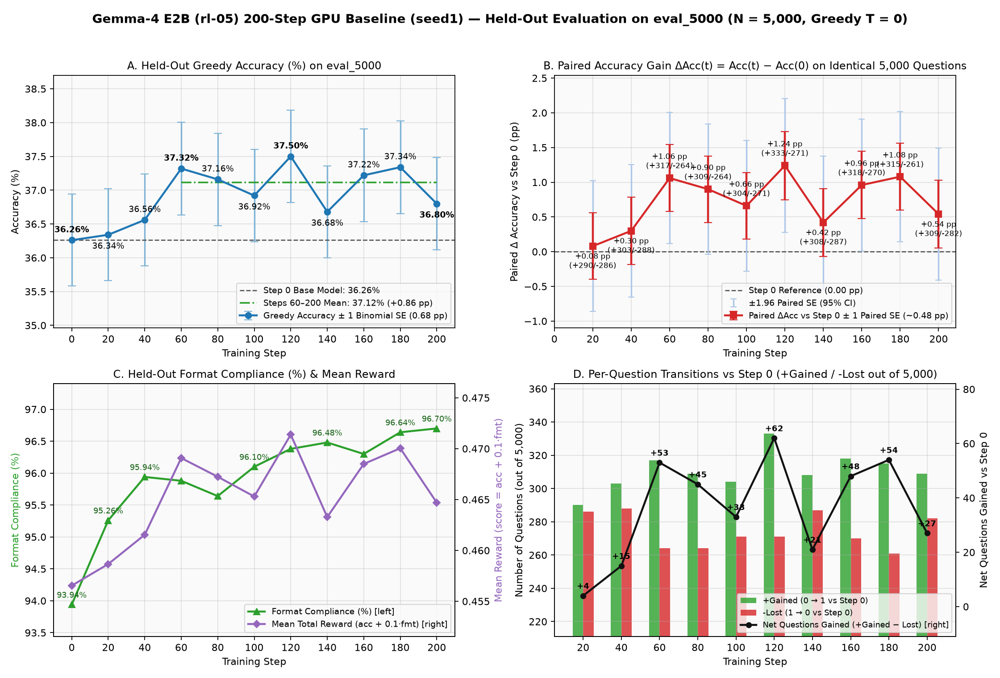
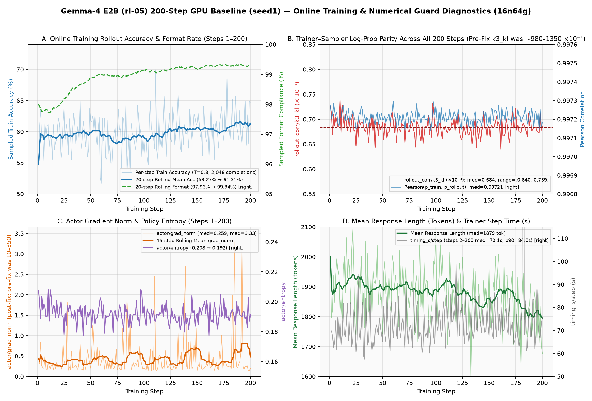
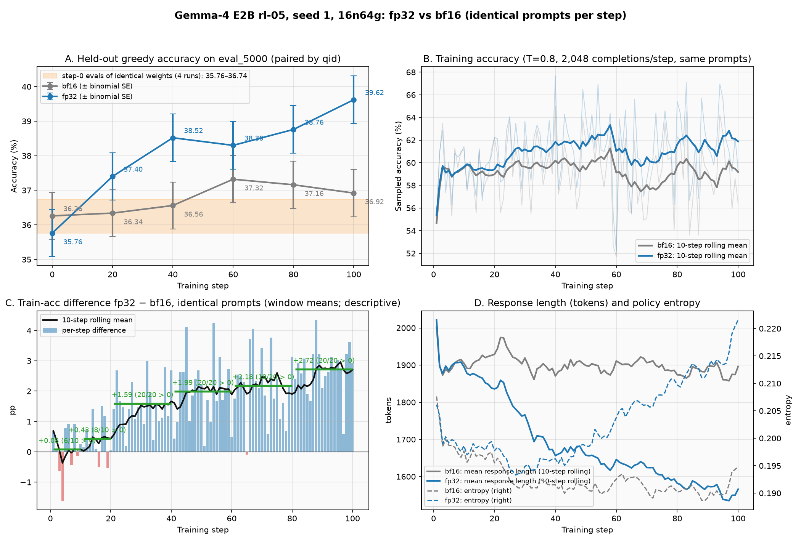

# Gemma-4 E2B (`gemma-4-E2B-it`) GRPO (`rl-05` parity) on GKE A4X (GB200)

**Historical learning reference:** [Qwen3-0.6B post-trained results](QWEN3_0P6B_REFERENCE.md) consolidates the GSM8K and OMI2 recipes, fixed-endpoint seed results, eval protocols, timing and artifact provenance for Gemma recipe optimization.

Colocated `verl` GRPO (DAPO clip-higher) launcher, GKE A4X (`a4x-highgpu-4g-a4x-pool-7`) manifests, the 20-step scaling logs (`1n4g`–`16n64g`), and a 4-step smoke of the committed launcher for `google/gemma-4-E2B-it` on the `rl-05` workload.

> [!IMPORTANT]
> **Status: smoke passed; trainer–sampler log-prob parity fixed; accuracy gate pending.**
> - Launch / training-flow smoke: **complete** (§3). Four steps with non-zero updates, driver `exit_code=0`.
> - Numerical correctness: **fixed** ([LOGPROB_PARITY.md](LOGPROB_PARITY.md)). The FSDP trainer computed wrong log-probs on ~half of its ranks because RoPE buffers were scrambled at FSDP init; the vLLM rollout was correct. With [`patch_verl_gemma4_rope_buffers.py`](patch_verl_gemma4_rope_buffers.py) applied on every pod, trainer and rollout agree to bf16 noise (step 1 at T=1: `k3_kl` 0.98 → 0.00046, Pearson 0.51 → 0.9992). Trainer-side metrics from earlier runs (k3, entropy, `grad_norm`) are invalid. Their step times are kept as a historical record; the post-fix 4-step smoke shows no obvious regression (§3.2), but post-fix throughput has not been measured.
> - Fix persistence and guard: the launcher now runs [`gemma4_node_prep.py`](gemma4_node_prep.py) on every launch, which brings every Ray node to "verl pin + managed patches" and aborts unless all nodes pass. Inside the trainer, the `[GEMMA4-ROPE]` guard checks every rank's RoPE buffers right after the FSDP wrap and fails the whole job if any rank is wrong ([ROPE_GUARD.md](ROPE_GUARD.md)).
> - Accuracy / convergence: **FP32 seed 1 clearly learns; recipe optimization and multi-seed validation remain open** (§4, [EVAL_PROTOCOL.md](EVAL_PROTOCOL.md)). The PR #9 BF16 seed 1 ran 200 steps stably (`k3_kl = 0.000640 – 0.000739`), but its held-out `eval_5000` change at the predeclared step-200 endpoint is **+0.54 pp** (36.26% → 36.80%, question-paired bootstrap 95% [−0.48, +1.48] pp), the same size as the difference between two greedy evals of identical weights. Seeds 2/3 of this recipe are on hold. [PR #10](UPDATE_PRECISION_RESULTS.md) measured that the BF16 optimizer path retained only 12–17% of the intended AdamW update norm in the two-step probe; in a 60-step A/B on identical prompts, FP32 persistent weights and moments learned faster (training accuracy +1.87 pp in steps 41–60; held-out +2.20 pp vs its own step 0 at step 60). The FP32 configuration is now frozen in the launcher (sha256 `7d511735…`). Its seed 1 was stopped at step 107 by decision. At step 100, held-out accuracy is **39.62%**: +3.86 pp vs its own step 0 (95% [+2.82, +4.96]) and +2.70 pp vs BF16 at the same step ([+1.64, +3.74]). FP32 clearly learns, but recipe optimization remains open. Qwen3-0.6B `stab_kl0` gained +12.1 pp by step 100 on its own held-out set; differences in model, held-out set and recipe make this context, not an acceptance threshold. Recipe ablations, with 100-step screens, continue in PR #11 ([UPDATE_PRECISION_RESULTS.md](UPDATE_PRECISION_RESULTS.md) §4).

---

## 1. Frozen workload & recipe (`run_gemma4_e2b_rl05_parity.sh`)

| Parameter | Value | Notes |
|---|---|---|
| Model | `google/gemma-4-E2B-it` | `GEMMA_MODEL_PATH` (default `/workspace/meta-RL/models/gemma-4-E2B-it`); deliberately not `MODEL_PATH`, which `/workspace/setup_env.sh` sets to Qwen |
| Dataset | `OpenMathInstruct-2` | `GEMMA_DATA_DIR` (default `/workspace/meta-RL/data/openmathinstruct2`; `GEMMA_TRAIN_FILE` / `GEMMA_VAL_FILE` for single files); deliberately not `DATA_DIR`, which `setup_env.sh` sets to `gsm8k_boxed`. 950,000 train / 50,000 val rows |
| Batch & rollout | `train_batch_size=256`, `rollout.n=8` | 2,048 completions per step, `ppo_mini_batch_size=256` ($\mu=1$ update per step) |
| Sequence lengths | `max_prompt_length=8192`, `max_response_length=8192` | `filter_overlong_prompts=False`, `truncation=error` |
| Algorithm & loss | `adv_estimator=grpo`, `use_kl_loss=False` ($\beta=0$) | Clip-higher `clip_ratio_low=0.2`, `clip_ratio_high=0.28`, `entropy_coeff=0` |
| Optimizer & precision | `lr=1e-6`, `grad_clip=1.0`, AdamW (0.9, 0.999), wd 0.01 | FSDP1 with **FP32 persistent weights and Adam moments** (`actor.fsdp_config.model_dtype=fp32`, since PR #10; launcher sha256 `7d511735…`), BF16 compute (FSDP mixed precision) and BF16 rollout weights; gradient checkpointing, `use_remove_padding=True`. The PR #9 BF16 reference used `model_dtype=bfloat16` (launcher sha256 `8646c173…`) |
| Dynamic batching | `ppo_max_token_len_per_gpu=16384` | Lowered from Qwen's 32768 because of Gemma-4's 262,144-token vocab (peak reserved HBM 51–53 GB/GPU in the smoke) |
| Rollout (vLLM) | `tp=1`, `gpu_memory_utilization=0.30` | `temperature=0.8`, `top_p=0.95`, `top_k=50`, `max_num_batched_tokens=32768`, chunked prefill, prefix caching |
| Trainer attention | `attn_implementation=flex_attention` (`ATTN_IMPL`) | With the `[GEMMA4]` Triton tile pinning for `head_dim=512` (§2) |
| Reward | `maxtext_math_reward.py` (`compute_score`) | `math-verify==0.9.0` + `sympy` |
| Eval | **disabled** | `trainer.test_freq=-1`, `trainer.val_before_train=False` (§4) |

---

## 2. Gemma-4 system & kernel notes on GB200

1. **vLLM attention**: Gemma-4 E2B mixes `head_dim=256` (sliding-window layers) and `head_dim=512` (global layers). The launcher does not set a vLLM attention backend. In this image, vLLM 0.29.0 used FlashInfer (smoke log: `Using TRTLLM prefill attention (auto-detected)`; TRT-LLM-gen cubins for both `H256` and `H512` are loaded).
2. **Trainer `flex_attention` tile pinning (`head_dim > 256`)**: Inductor's default `flex_attention` tiles overflow the GB200 227 KB SMEM/CTA limit at `head_dim=512`. `_verl_patch_flex_kernel_options()` (in `verl/models/transformers/monkey_patch.py`; `patch_verl_gemma4_flex_attn.py` applies it to a `/workspace/verl-pin` checkout) pins the measured tiles:
   - Forward: `BLOCK_M=32, BLOCK_N=128, num_warps=8, num_stages=1`
   - Backward: `BLOCK_M1=32, BLOCK_N1=32, BLOCK_M2=32, BLOCK_N2=32, num_warps=8, num_stages=1`
3. **Packed-sequence isolation gate (`gemma_pack_gate.py`)**: single GPU, short sequences, `torch.no_grad()`, no memory measurement. It checks that HF's packed-sequence masking (restarted `position_ids`, `attention_mask=None`) keeps packed sequences from attending to each other by comparing `[A; B]` with `[A'; B]` (`A'` = token-shuffled `A`) at `96+80` tokens (inside the sliding window) and `640+560` tokens (crossing it). It passes only if `max |logits_B(A') - logits_B(A)| < 1e-3` and exits `1` otherwise.
   - Verified on GB200 with `--attn sdpa` (current file, sha256 `6855d7b7…`): LEAKAGE max `0.0000` in both rounds, exit `0`. A PASS only reports that no leakage was seen under these conditions; it does not by itself explain training metrics such as `grad_norm`.
   - **Not covered: `--attn flex_attention`, which the trainer uses.** On torch 2.13 the 80-token reference forward is routed to Inductor's flex-decoding kernel, which has no valid configs here (`NoValidChoicesError`), so the gate exits `1` before reaching a verdict. The gate also does not import verl's `head_dim > 256` tile patch. Packing isolation under `flex_attention` is therefore not verified by this gate. The offline parity ladder in [LOGPROB_PARITY.md](LOGPROB_PARITY.md) §2 does cover it: in verl's packed layout, `flex_attention` matches unpacked to bf16 noise.
4. **Trainer RoPE buffers (required fix)**: transformers' `Gemma4TextRotaryEmbedding` registers its RoPE buffers in hash-randomized `set` order, and verl's FSDP1 `sync_module_states` broadcasts buffers by position, so on ~half of the ranks the RoPE frequencies were scrambled. verl's `module.to(model_dtype)` also rounded them to bf16. The launcher installs the fix on every node at every launch (`gemma4_node_prep.py`), and the `[GEMMA4-ROPE]` guard verifies it on every rank; see [ROPE_GUARD.md](ROPE_GUARD.md) and [LOGPROB_PARITY.md](LOGPROB_PARITY.md).

---

## 3. 4-step smoke of the committed launcher (`4n16g`, `flex_attention`) — complete

### 3.1 What ran

- Launcher: the 4-step smoke ran `run_gemma4_e2b_rl05_parity.sh` at sha256 `c5f5a0f86c56f6991de1f656c19538c50b1e6a3f622062156363bee7a0b850d6` (`8927660b03a1f99721287dc347887d9b16cfbd8e8bc943c9b4f13817be0ab318` after removing stale vLLM comment lines; non-comment sha256 `5dc43e0787e4b928e25ebb174b637b72de0e5d5c77f2d2d9b52ce4fd87cdef76`). The current launcher (`8646c17331d84ac95a5183ffae4880f2150889a864fe1ff88ba5c79390ea66d0`) adds the pre-launch `gemma4_node_prep.py` call and `VERL_GEMMA4_ROPE_REPORT_DIR=${GUARD_DIR}` (verified in `logs/gemma4_e2b_4n16g_guard_smoke2_1021_1926.log`; see [ROPE_GUARD.md](ROPE_GUARD.md)).
- Command, in the Ray head pod, right after `source /workspace/setup_env.sh` (which exports `DATA_DIR=.../gsm8k_boxed` and `MODEL_PATH=.../Qwen3-0.6B`):
  `NNODES=4 TOTAL_STEPS=4 bash run_gemma4_e2b_rl05_parity.sh` — no extra overrides.
- Log checks (`logs/gemma4_e2b_4n16g_smoke4steps_1020_2258.log`):
  - data and model resolved to `openmathinstruct2/{train,val}.parquet` and `gemma-4-E2B-it` despite the Qwen exports;
  - `ray init kwargs` shows `'REWARD_DUMP_EVERY': '256', 'VLLM_NO_USAGE_STATS': '1', 'DO_NOT_TRACK': '1'` as strings;
  - `actor/lr = 1e-6` and non-zero `actor/grad_norm` at every step;
  - the log ends with `[driver] main_ppo finished with exit_code=0` (followed by the `set -x` trace `+ exit 0`).

### 3.2 Step time (`step_time_report.py`)

| Run | Log | Steps | Median (s) | Mean (s) | p90 (s) | Max (s) | Rollout (s) | Train (s) | `update_actor` (s) | `old_log_prob` (s) | Other (s) |
|---|---|---|---|---|---|---|---|---|---|---|---|
| 20-step reference (`4n16g`) | `logs/gemma4_e2b_4n16g_official_0902_0439.log` | 2–20 (n=19) | **76.2** | 76.5 | 79.6 | 79.8 | 41.4 (54%) | 28.9 | 21.8 | 7.1 | 6.4 |
| **Smoke, committed launcher** | `logs/gemma4_e2b_4n16g_smoke4steps_1020_2258.log` | 2–4 (n=3) | **77.7** | 77.9 | 80.6 | 81.3 | 38.2 (49%) | 33.6 | 25.4 | 8.3 | 4.3 |
| Smoke, incl. compile step | same | 1–4 (n=4) | 79.5 | 90.5 | 114.0 | 128.0 | 39.0 (49%) | 34.6 | 26.2 | 8.5 | 4.3 |
| Earlier run (pre-fix launcher + manual CLI overrides; superseded) | `logs/gemma4_e2b_4n16g_val4steps_1020_0945.log` | 2–4 (n=3) | 78.3 | 78.8 | 81.4 | 82.2 | 38.1 (49%) | 35.9 | 27.7 | 8.7 | 4.3 |
| Smoke after the RoPE-buffer fix ([LOGPROB_PARITY.md](LOGPROB_PARITY.md) §6) | `logs/gemma4_e2b_4n16g_smoke4steps_fixed_1021_0822.log` | 2–4 (n=3) | 74.0 | 75.8 | 78.5 | 79.6 | 37.1 (50%) | 33.5 | 25.4 | 8.3 | 4.3 |

Per step (smoke):

| Step | Step (s) | Rollout (s) | Train (s) | `update_actor` (s) | `old_log_prob` (s) | Other (s) | Mean resp. len (tok) | Mean score | `grad_norm` | `lr` | Peak reserved HBM (GB) |
|---|---|---|---|---|---|---|---|---|---|---|---|
| 1 (compile) | 128.0 | 50.2 | 73.6 | 37.0 | 36.6 | 4.2 | 1,763 | 0.727 | 4.65625 | 1e-6 | 51.2 |
| 2 | **74.8** | 37.0 | 33.5 | 25.3 | 8.3 | 4.3 | 1,878 | 0.695 | 6.4375 | 1e-6 | 51.6 |
| 3 | **77.7** | 39.8 | 33.6 | 25.4 | 8.2 | 4.3 | 1,771 | 0.765 | 9.0625 | 1e-6 | 51.9 |
| 4 | **81.3** | 38.2 | 35.7 | 27.0 | 8.7 | 7.4 | 2,084 | 0.672 | 7.3125 | 1e-6 | 52.9 |

"Mean score" is the sampled training reward (T=0.8) on that step's 256 prompts, not held-out accuracy.

### 3.3 Known exit-phase issue: `DataLoader worker ... killed`

This is recorded as an exit-phase issue: it does not change the driver exit code. `RuntimeError: DataLoader worker (pid 6527) is killed by signal: Killed.` appears after `Training Progress: 100% 4/4`. The traceback is raised by PyTorch's DataLoader SIGCHLD handler while the TaskRunner sits in Ray's `run_task_loop()`, with no training frames on the stack, i.e. after `TaskRunner.run()` returned. That is consistent with, but not proof of, Ray SIGKILL-ing the actor's child DataLoader workers at teardown. All four step lines were logged and the driver exited `0`. The same message is present at the end of all six 09-02 20-step logs.

### 3.4 Rollout vs trainer log-probs (`rollout_corr/k3_kl` ≈ 1.3) — resolved

**Resolved ([LOGPROB_PARITY.md](LOGPROB_PARITY.md)).** The gap came from the trainer, not the sampler. On 7 of 16 FSDP ranks the RoPE buffers were scrambled at init, so every log-prob computed on those ranks was wrong; the vLLM rollout matched HF and an offline vLLM prefill to bf16 noise. After `patch_verl_gemma4_rope_buffers.py`, the trainer matches the rollout to bf16 noise. The analysis below was written before the root cause was known and is kept for the record. Its convention argument (truncation cannot explain the gap) still holds.

**Conventions (code, verl pin `ace775e8`, vLLM 0.29.0):**
- Rollout log-probs: `actor_rollout_ref.rollout.logprobs_mode=processed_logprobs` (verl default in `verl/trainer/config/rollout/rollout.yaml`, passed to the vLLM engine in `vllm_async_server.py`). vLLM applies temperature, then `apply_top_k_top_p` masking, then `log_softmax` (`v1/sample/ops/topk_topp_sampler.py`), i.e. log-probs renormalized over the kept top-k/top-p set.
- Trainer `old_log_prob`: `log_softmax(logits / T)` over the full 262,144-token vocabulary (`verl/workers/engine/fsdp/transformer_impl.py`).

**Can the convention difference explain the gap? No, by a bound on the logged metrics.** If vLLM and the trainer had the same temperature-scaled distribution, then for each sampled token, rollout − trainer log-prob $= -\log Z_t$, where $Z_t$ is the trainer's mass on the kept set. The kept set always contains the argmax, so $Z_t \ge p_{\max,t} \ge e^{-H_t}$, giving $-\log Z_t \le H_t$. Token-averaging over the same response tokens gives `rollout_corr/kl` ≤ `actor/entropy`. The smoke violates this by about 4×:

| Smoke step | `rollout_corr/kl` | `actor/entropy` | `rollout_corr/k3_kl` | `training_log_ppl` / `rollout_log_ppl` | Pearson(p_train, p_rollout) |
|---|---|---|---|---|---|
| 1 | 1.549 | 0.398 | 1.306 | 1.336 / 0.115 | 0.409 |
| 2 | 1.596 | 0.408 | 1.349 | 1.393 / 0.125 | 0.416 |
| 3 | 1.552 | 0.404 | 1.308 | 1.357 / 0.117 | 0.410 |
| 4 | 1.648 | 0.399 | 1.398 | 1.433 / 0.126 | 0.407 |

**A/B with truncation off** (same launcher plus `actor_rollout_ref.rollout.top_k=-1 actor_rollout_ref.rollout.top_p=1.0`, 2 steps; with no top-k/top-p, `processed_logprobs` uses exactly the trainer's convention; `logs/gemma4_e2b_4n16g_diag_notrunc_1021_0610.log`). The resolved config shows `top_k: -1`, `top_p: 1.0`:

| Run | Step | `rollout_corr/kl` | `actor/entropy` | `rollout_corr/k3_kl` | `training_log_ppl` / `rollout_log_ppl` | Pearson(p_train, p_rollout) |
|---|---|---|---|---|---|---|
| Smoke (top-k 50, top-p 0.95) | 1 | 1.549 | 0.398 | 1.306 | 1.336 / 0.115 | 0.409 |
| Smoke (top-k 50, top-p 0.95) | 2 | 1.596 | 0.408 | 1.349 | 1.393 / 0.125 | 0.416 |
| A/B, truncation off | 1 | 0.972 | 0.413 | 0.846 | 1.018 / 0.146 | 0.482 |
| A/B, truncation off | 2 | 1.018 | 0.437 | 0.886 | 1.057 / 0.157 | 0.485 |

**Reading.** With truncation off the two log-probs use the same convention, so a matched rollout/trainer pair should give `kl` and `k3_kl` near zero, at bf16-noise level. For scale, the Qwen3-0.6B recipe on the same verl pin reports `k3_kl` ≈ 7e-4 (`my_scripts_GKE_gsm8k_disagg/README.md`). Here `k3_kl` stays at 0.85–0.89, `kl` at 0.97–1.02, and Pearson at 0.48. The probability convention is therefore not the main cause: there is a real Gemma-4 rollout-vs-trainer mismatch, not yet localized. Candidates, none tested here:
- the trainer's packed `flex_attention` path (the gate covers `sdpa` only, §2.3);
- vLLM-vs-HF numerics for Gemma-4;
- rollout weight sync;
- token/log-prob alignment.

Next step (separate from this smoke): keep the truncation-off sampling and switch `ATTN_IMPL=sdpa` for 2 steps. This separates the trainer's `flex_attention` path, which the gate does not cover, from the rest. If the gap persists, follow up with an offline single-GPU HF-vs-vLLM log-prob comparison on identical token sequences.

The 09-02 runs used an older verl checkout that did not log these metrics, so they cannot show whether the gap existed then.

---

## 4. Accuracy gate — protocol frozen ([EVAL_PROTOCOL.md](EVAL_PROTOCOL.md)); BF16 and FP32 seed-1 references only, recipe ablations next (PR #11)

- **Gate (customer, Meta)**: $\overline{\text{Acc}}_{\text{TPU}}(200) \ge \overline{\text{Acc}}_{\text{GPU}}(200) - 1.0\text{ pp}$, where $\overline{\text{Acc}}(200) = \frac{1}{3}\sum_{s=1}^{3} \text{Acc}_s(200)$ is the **3-seed arithmetic mean** held-out greedy accuracy on `eval_5000.parquet` at the pre-declared **final checkpoint (step 200)** ([EVAL_PROTOCOL.md](EVAL_PROTOCOL.md) §3.1). Full 11-point learning curves (`steps 0, 20, ..., 200`), across-seed standard deviation / min–max spread, and within-seed paired SEs vs step 0 are reported alongside the step-200 gate to prevent post-hoc checkpoint cherry-picking.
- **Frozen held-out set (`eval_5000.parquet`)**: built deterministically by [`build_gemma4_eval_set.py`](build_gemma4_eval_set.py) ([`eval_5k/manifest.json`](eval_5k/manifest.json)). In raw `val.parquet` (50,000 rows), **37,372 rows (74.7%) overlap `train.parquet`** after alphanumeric normalization. Excluding all train-overlapping questions and deduplicating by question leaves 11,652 unique problems, from which 5,000 are selected by ascending `sha256(key)` (`eval_5000.parquet`, sha256 `d092a9c5e80aa2b3cf8e4e12d8367769e770f69ee6627ff1285fd5693efc662d`, binomial SE $\approx 0.70\text{ pp}$ at 55%).
- **Frozen prompt-token ID fixture**: [`eval_5k/eval_5000_prompt_tokens.parquet`](eval_5k/eval_5000_prompt_tokens.parquet) (sha256 `a54fbb327d9c60545c49edfc26107b21a1e55f3ef9e673d80024c79e821b5ca4`), rendered through `verl`'s `Gemma4VLContinuousTokenBuilder` (`Gemma4Processor` + `GemmaTokenizer`) and verified 256/256 token-exact against online rollout prompts.
- **Frozen 200-step baseline protocol ([`run_gemma4_e2b_rl05_accuracy_baseline.sh`](run_gemma4_e2b_rl05_accuracy_baseline.sh))**: `TOTAL_STEPS=200`, `trainer.val_before_train=True`, `trainer.test_freq=20` (11 checkpoints: steps `0, 20, ..., 200`), greedy decoding (`do_sample=False, temperature=0, top_k=-1, top_p=1.0, n=1`), explicit `SEED=1, 2, 3`.
- **BF16 seed 1 (`gemma4_e2b_rl05_16n64g_s200_seed1_1021_1955`, `16n64g`) — complete, kept as the original-recipe reference ([EVAL_PROTOCOL.md](EVAL_PROTOCOL.md) §5, [`eval_5k/seed1_16n64g/seed1_report.md`](eval_5k/seed1_16n64g/seed1_report.md))**:
  - Guard check: [`eval_5k/seed1_16n64g/guard_check.txt`](eval_5k/seed1_16n64g/guard_check.txt) (**16/16 PASS**, `16/16` nodes, `64/64` unique ranks, `exit_code=0`, `steps=0..200`).
  - Numerical stability across all 200 steps: `rollout_corr/k3_kl = 0.000640 – 0.000739` (median `0.000684`), `actor/grad_norm = 0.1289 – 3.3281` (median `0.2588`).
  - Held-out `eval_5000`: step 0 **36.26%** → predeclared step-200 endpoint **36.80%** (+0.54 pp, question-paired bootstrap 95% [−0.48, +1.48] pp); intermediate checkpoints 36.34–37.50%. Two greedy evals of identical step-0 weights differ by +0.48 pp (+305 / −281 questions), so this change is not distinguishable from eval nondeterminism. Format compliance 93.94% → 96.70% (not monotonic).
  - Seed 2 of this recipe was stopped at step 147; seed 3 was not launched. Any revised-precision recipe restarts from seed 1 and is not pooled with these BF16 seeds ([UPDATE_PRECISION_RESULTS.md](UPDATE_PRECISION_RESULTS.md)).
- **FP32 seed 1 (`gemma4_e2b_rl05fp32_16n64g_s200_seed1_1022_2019`, `16n64g`, frozen launcher sha256 `7d511735…`). Stopped at step 107 by decision; steps 0–100 reported ([UPDATE_PRECISION_RESULTS.md](UPDATE_PRECISION_RESULTS.md) §4, [`update_precision/fp32_seed1_100steps/`](update_precision/fp32_seed1_100steps/)). This is a separate cohort.**
  - Held-out `eval_5000`: 35.76% at step 0, then 37.40 / 38.52 / 38.30 / 38.76 / **39.62%** at steps 20 / 40 / 60 / 80 / 100. At step 100 that is +3.86 pp vs its own step 0 (question-paired bootstrap 95% [+2.82, +4.96]) and +2.70 pp vs BF16 seed 1 at the same step ([+1.64, +3.74]).
  - Training accuracy on the same prompts as BF16 seed 1: +1.75 pp averaged over steps 1–100, with FP32 ahead in 93 of 100 steps. This is descriptive; consecutive steps are not independent replicates.
  - RoPE guard PASS on 64 / 64 ranks and node prep PASS. `rollout_corr/k3_kl` stayed near 7e-4. The driver exit code is 1 only because the run was stopped.
- **Trainer log-prob parity (§3.4) and persistence/guard ([ROPE_GUARD.md](ROPE_GUARD.md)) are resolved and enforced on every launch.**







---

## 5. Scaling sweep (`1n4g` to `16n64g`, steps 2–20)

Generated by `python3 step_time_report.py <log> 2 20` (exact output in [`step_time_summary.txt`](step_time_summary.txt)). All runs: `train_batch_size=256`, `n=8`, `rollout_tp=1`, `ppo_max_token_len_per_gpu=16384`, eval off.

| Scale | GPUs ($W$) | Trainer attn | Median (s) | Mean (s) | p90 (s) | Max (s) | Rollout (s) | Train (s) | `update_actor` (s) | `old_log_prob` (s) | Other (s) | Log |
|---|---|---|---|---|---|---|---|---|---|---|---|---|
| `1n4g` | 4 | `flex_attention` | **172.7** | 172.4 | 180.3 | 183.4 | 72.4 (42%) | 95.9 | 77.2 | 19.4 | 5.7 | `logs/gemma4_e2b_1n4g_official_0902_0645.log` |
| `2n8g` | 8 | `flex_attention` | **108.8** | 112.7 | 116.6 | 164.0 | 51.1 (47%) | 51.2 | 40.2 | 11.2 | 6.3 | `logs/gemma4_e2b_2n8g_official_0902_0536.log` |
| `4n16g` | 16 | `flex_attention` | **76.2** | 76.5 | 79.6 | 79.8 | 41.4 (54%) | 28.9 | 21.8 | 7.1 | 6.4 | `logs/gemma4_e2b_4n16g_official_0902_0439.log` |
| `8n32g` | 32 | `flex_attention` | **63.2** | 63.0 | 63.9 | 66.2 | 37.6 (60%) | 19.0 | 13.6 | 5.4 | 6.3 | `logs/gemma4_e2b_8n32g_official_0902_0336.log` |
| `16n64g` | 64 | `flex_attention` | **57.8** | 57.7 | 58.6 | 59.1 | 36.3 (63%) | 15.3 | 10.3 | 4.9 | 6.1 | `logs/gemma4_e2b_16n64g_official_0902_0114.log` |
| `16n64g` | 64 | `sdpa` | **78.0** | 78.2 | 80.6 | 82.0 | 36.2 (46%) | 35.7 | 29.0 | 6.9 | 5.9 | `logs/gemma4_e2b_rl05_16n64g_official_sdpa_0902_0220.log` |

Component columns are per-component medians, so they do not sum to the step median.

---

## 6. Directory contents

| File | Description |
|---|---|
| `run_gemma4_e2b_rl05_parity.sh` | Launcher: frozen `rl-05` block, `GEMMA_DATA_DIR` / `GEMMA_MODEL_PATH` isolation, chat-template preflight, node prep on every launch (aborts unless every node passes), string-quoted Ray env vars, prints `[driver] main_ppo finished with exit_code=N` and exits with it |
| `gemma4_node_prep.py` | Run by the launcher on the Ray head: one hard-node-affinity task per alive node; pins `math-verify` (+2 deps), rebuilds the managed verl files from the pin + patchers, restores any other modified tracked file, import-checks, and writes per-node provenance (`<guard_dir>/node_prep.json`) |
| `maxtext_math_reward.py` | Math reward (`compute_score`) matching MaxText `rl-05` grading (`math-verify` + `sympy`) |
| `patch_verl_gemma4_flex_attn.py` | Idempotent patcher adding `_verl_patch_flex_kernel_options` (`head_dim > 256` tiles) to `monkey_patch.py` |
| `gemma_pack_gate.py` | Packed-sequence isolation gate (§2.3); exits `1` on FAIL or error |
| `step_time_report.py` | Step-time median/mean/p90/max and phase breakdown from a driver log |
| `step_time_summary.txt` | Exact `step_time_report.py` output for the smoke and the six scaling logs |
| `verl-qwen3-raycluster.yaml` | 16-node (64-GPU) KubeRay `RayCluster` on `a4x-highgpu-4g-a4x-pool-7` with MNNVL `ComputeDomain` and GCS Fuse mounts |
| `compute-domain-a4x.yaml` | `ComputeDomain` (`numNodes: 16`) for MNNVL |
| `priorityclass-verl-high.yaml` | `PriorityClass` `verl-high` |
| `logs/` | Scaling logs, the smoke logs (before and after the RoPE fix), the truncation-off A/B logs (flex, sdpa), the parity fixture / rank-probe / post-fix verification runs, and the superseded pre-fix run |
| `LOGPROB_PARITY.md` | Trainer-vs-sampler log-prob parity: method, ladder results, per-rank localization, root cause, fix, verification |
| `patch_verl_gemma4_rope_buffers.py` | **Required fix + guard** (v2, upgrade-safe: replaces any older block). Sorts module buffers before the FSDP wrap; installs the `[GEMMA4-ROPE]` guard (registration check, all-rank init checkpoint after the FSDP wrap that rebuilds RoPE `inv_freq` in fp32, first-forward check) and its 2-line hook in `transformer_impl.py` ([ROPE_GUARD.md](ROPE_GUARD.md)) |
| `gemma4_guard_check.py` | Validates a run's evidence by unique node and unique rank: node prep, rank-0 guard report, per-rank records, driver exit code, steps; `--expect-fail-rank R` for the negative test |
| `test_gemma4_rope_guard.py` | Deterministic single-process tests of the installed guard (classifier states, tolerances, zeros / non-finite, rebuild, registration, checkpoint, fault injection, simulated FSDP1 broadcast) |
| `ROPE_GUARD.md` | Fix persistence (node prep) and the `[GEMMA4-ROPE]` guard: design, tolerances, evidence (unit tests, positive smoke, deterministic negative test) |
| `rope_guard/` | Evidence for `ROPE_GUARD.md`: node-prep reports, guard reports, checker outputs, unit-test output |
| `EVAL_PROTOCOL.md` | Frozen 5,000-problem evaluation set (`eval_5000.parquet`), prompt-token ID fixture (`eval_5000_prompt_tokens.parquet`), and 200-step GPU baseline protocol |
| `build_gemma4_eval_set.py` | Deterministic builder for `eval_5000.parquet` (zero overlap with `train.parquet`) and `eval_5000_prompt_tokens.parquet` |
| `run_gemma4_e2b_rl05_accuracy_baseline.sh` | Frozen 200-step GPU baseline wrapper around `run_gemma4_e2b_rl05_parity.sh` (`val_before_train=True`, `test_freq=20`, greedy decoding, explicit `SEED`) |
| `gemma4_eval_report.py` | Summarizes held-out `eval_5000` accuracy curves, binomial & paired standard errors vs step 0, and multi-seed statistics |
| `eval_5k/` | `manifest.json` and `eval_5000_prompt_tokens.parquet` (frozen prompt token IDs for all 5,000 eval problems) |
| `patch_verl_pin_logprob_fixture.py` | Diagnostic, env-gated (`LOGPROB_FIXTURE_DIR`): dumps the pre-update batch with token IDs and rollout/trainer log-probs, plus a repeated trainer pass. Not applied by node prep, which restores the file it touches |
| `patch_verl_pin_rank_probe.py` | Diagnostic, env-gated (`VERL_RANK_PROBE_DIR`): per-rank canary forward with per-module output and buffer checksums. Not applied by node prep, which rebuilds `transformer_impl.py` from the pin |
| `gemma4_logprob_parity.py` | Offline parity ladder on a fixture: HF backends, packed vs unpacked, vLLM prefill, online values; summary tables and error-vs-position plots |
| `logprob_parity/` | Ladder results before and after the fix (`summary.md`, plots, rank-probe comparisons, per-rank chunk stats) |
| `UPDATE_PRECISION_PLAN.md` / `UPDATE_PRECISION_RESULTS.md` | PR #10: plan and results of the weak-learning / optimizer-update-precision investigation |
| `gemma4_optim_probe/` | Env-gated Ray `worker_process_setup_hook` that wraps `torch.optim.AdamW.step` for the first N steps: optimizer-held dtypes, applied vs fp32-ideal update on the same gradients (moments x write-back 2x2), changed-element fractions, per original parameter. No change to verl or the managed files |
| `gemma4_optim_probe_report.py` / `test_gemma4_optim_probe.py` | Aggregates probe records over ranks (coverage check, totals, 2x2, categories); CPU self-test (bf16 vs fp32 positive control) |
| `gemma4_learning_signal.py` | Offline audit of rollout / eval dumps: GRPO group classes and advantage mass, eval pairing by validated `qid` with bootstrap intervals and an identical-weights replicate, grading audit |
| `gemma4_ab_compare.py` | Paired comparison of two runs with the same seed / data order: held-out by validated `qid` (bootstrap), training accuracy on identical prompts per step (windows 1–10, 11–20, then every 20 steps), diagnostics from the driver logs, optional 2x2 figure |
| `gemma4_signal_density.py` | GRPO signal density per step window from training dumps (correctness-mixed / all-correct / all-wrong / format-or-penalty-only groups, sampled accuracy); reads Gemma-4 and Qwen3 dumps alike |
| `update_precision/` | PR #10 evidence: reference manifest, audit, probe summaries and self-test, FP32 vs BF16 A/B (tables, figure, guard check), FP32 seed 1 steps 0–100 (`fp32_seed1_100steps/`: comparison with BF16, same-recipe reproducibility, eval report, signal density, guard check) |

---

## 7. How to deploy & run

### Deploy (GKE `a4x-baker`)
```bash
kubectl apply -f priorityclass-verl-high.yaml
kubectl apply -f compute-domain-a4x.yaml
kubectl apply -f verl-qwen3-raycluster.yaml
kubectl get raycluster verl-bench-xiaotongyang
```

### Prepare workers (`verl-disagg-cu130-arm64` image, `/workspace/verl-pin`)
Nothing to do by hand: the launcher runs `gemma4_node_prep.py` before `main_ppo` on every launch (pinned `math-verify`, flex tiles, `[GEMMA4-ROPE]` fix + guard on every alive Ray node; see [ROPE_GUARD.md](ROPE_GUARD.md)). To prepare and check the nodes without launching (Ray head pod):
```bash
source /workspace/setup_env.sh
python3 /workspace/meta-RL/verl/examples/grpo_trainer/my_scripts_GKE_gemma4/gemma4_node_prep.py \
  --report /workspace/meta-RL/logs/gemma4_guard/node_prep_$(date +%m%d_%H%M).json
```

### Optional packing gate (GPU worker pod)
```bash
python3 /workspace/meta-RL/verl/examples/grpo_trainer/my_scripts_GKE_gemma4/gemma_pack_gate.py \
  --model /workspace/meta-RL/models/gemma-4-E2B-it --attn sdpa
```

### Smoke (`4n16g`) or 20-step run (Ray head pod)
```bash
source /workspace/setup_env.sh
SCRIPT_DIR=/workspace/meta-RL/verl/examples/grpo_trainer/my_scripts_GKE_gemma4
EXP=gemma4_e2b_4n16g_smoke4steps_$(date +%m%d_%H%M)
LOG=/workspace/meta-RL/logs/$EXP.log
EXPERIMENT_NAME=$EXP NNODES=4 TOTAL_STEPS=4 bash "$SCRIPT_DIR/run_gemma4_e2b_rl05_parity.sh" 2>&1 | tee "$LOG"
grep -a "\[driver\]" "$LOG"                     # [driver] main_ppo finished with exit_code=0
python3 "$SCRIPT_DIR/gemma4_guard_check.py" --log "$LOG" --guard-dir /workspace/meta-RL/logs/gemma4_guard/$EXP --world 16 --steps 4
python3 "$SCRIPT_DIR/step_time_report.py" "$LOG" 2 4
```
