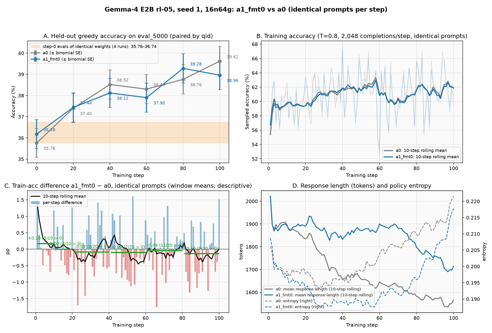

# Gemma-4 FP32 recipe ablation plan (PR #11)

## Gist

Optimize the already-learning Gemma-4 E2B FP32 recipe by isolating the effects of training format reward, prompt wrapping, and learning-rate magnitude. Use independent 100-step seed-1 screens against PR #10's fixed steps 0–100, then freeze a candidate before multi-seed validation.

PR #10 established learning, not a plateau: held-out accuracy rose **35.76% → 39.62% (+3.86 pp)** at step 100, with question-paired bootstrap 95% **[+2.82, +4.96] pp**. Its run was deliberately stopped at step 107; only steps 0–100 are the comparison reference. Qwen results motivate optimization but are not a Gemma acceptance threshold.

**Status:** A1 (reward) is complete: not a candidate (see [A1 result](#a1-result-100-steps-complete)). A2 (prompt) is running; its start check passed. A3a (LR 2e-6) is predeclared and follows A2. See the [execution record](#execution-record). The initial commit was plan only.

## Plan

### 1. Freeze the comparison reference

- [x] Anchor the plan to merged PR #10, commit `11c9486ecbdd2f47222a2b38db6d9292961db7c6`.
- [x] Reference run: `gemma4_e2b_rl05fp32_16n64g_s200_seed1_1022_2019`; use only steps 0–100.
- [ ] Record each arm's command, resolved configuration, code/launcher/reward hashes, model identity, dataset hashes and experiment ID before reading its result.
- [ ] Verify the only intended recipe difference from the reference; keep the reference files and evidence unchanged.

Reference evidence: [precision results §4](UPDATE_PRECISION_RESULTS.md#4-fp32-seed-1-steps-0100-plan-item-4--stopped-at-step-107), [100-step artifacts](update_precision/fp32_seed1_100steps/), and [frozen evaluation protocol](EVAL_PROTOCOL.md).

### 2. Run independent single-factor screens in this order

| Arm | Only intended change vs PR #10 FP32 reference | Explicitly unchanged |
|---|---|---|
| A0: reference | None; reuse PR #10 steps 0–100 | Original FP32 recipe |
| A1: reward | Training format coefficient **0.1 → 0** | Correctness scorer/extraction/normalization, format detection, length penalty, prompt, sampling, LR and eval |
| A2: prompt | Remove the embedded inner turn-template wrapper from **training prompts only**; apply the Gemma chat template once | Raw question text/order/IDs, answer, instruction wording and requested answer format, reward coefficient **0.1**, LR and eval prompts |
| A3: LR | Change only LR magnitude from **1e-6**; record the candidate value(s) before launch | Constant schedule with no warmup, original reward **0.1**, original double-wrapped prompt, all other settings |

**Every arm starts fresh from the same initial checkpoint, with seed 1 and reset optimizer state.** Do not resume the step-100 checkpoint or carry over the previous arm's changes. A2 does not inherit A1's reward change; A3 does not inherit A1 or A2. Any later combined recipe is a separately labeled experiment, not one of these single-factor arms.

Common settings: `16n64g`; FP32 persistent optimizer weights and moments, BF16 compute/rollout; 256 prompts × 8 completions; one optimizer update per rollout batch; unchanged GRPO/DAPO objective and clipping, no KL; prompt/response caps 8192/8192; sampling T=0.8, top-k=50, top-p=0.95; unchanged attention, node prep and RoPE guards. Preserve seed settings and actual per-step question membership/order.

All screens use **100 training steps**, eval at **0, 20, 40, 60, 80, 100**, and the existing 5,000-question greedy evaluation. Set the experiment name to identify the arm and `s100`; the existing wrapper's default name still contains `s200`.

### 3. Prepare each changed path before its long run

**A1 — reward**

- [x] Make the format-coefficient change explicit in the actual Ray reward workers; a head-shell environment variable alone is not sufficient evidence. — implemented (see [A1 record](#a1-record-training-format-coefficient-0)) and confirmed in the run's own dumps: every training row at steps 1–3 has `fmt_coef` 0 and `score = acc`; every eval row at step 0 keeps 0.1.
- [x] Preserve `acc` and binary `fmt` reporting. Check representative completions: training score changes from `acc + 0.1 * fmt` to `acc`, while correctness and format flags stay unchanged; length penalty remains disabled. — [`test_maxtext_reward_fmt_scope.py`](test_maxtext_reward_fmt_scope.py) PASS.
- [x] Keep eval grading unchanged: `acc`, `fmt`, and canonical `score = acc + 0.1 * fmt`. The current scorer reads `REWARD_FMT_WEIGHT` process-wide, so a global zero override would also change eval total reward. Scope the ablation to training, and verify that eval keeps its frozen coefficient. — scoped by eval-question membership and tested; confirmed in the run's step-0 validation dump (5,000 / 5,000 rows).
- [x] Check both correct/incorrect and formatted/unformatted cases before the 100-step run. — all four cases, for both training and eval rows.

Removing format credit mechanically lowers total reward. Compare accuracy and format rate separately; do not treat a lower total reward as a learning regression.

**A2 — prompt**

- [x] Build a separate training-data artifact; preserve the reference parquet. Remove only the known inner template markers and fake model header, retaining the original instructions, question and requested response format. — `train_single_wrap.parquet` (sha256 `053185b1…`), built by [`gemma4_build_single_wrap_train.py`](gemma4_build_single_wrap_train.py); `train.parquet` unchanged.
- [x] Preserve row IDs/order and ground truths. Save before/after rendered samples and token counts; check no unexpected truncation, row filtering or question-content changes. — [manifest](recipe_ablation/a2_prompt/train_single_wrap_manifest.json); details in the [A2 record](#a2-record-training-template-applied-once).
- [x] Extend [`gemma4_ab_compare.py`](gemma4_ab_compare.py) with an explicit training-template-change comparison mode. Its current strict `qid -> (rendered input, ground truth)` check correctly rejects this arm. — `--train-template-change strip_inner_gemma3`.
- [x] In that mode, validate original row/question identity and raw question/answer hashes against a provenance mapping; validate complete steps, 2,048 rows, 256 groups × 8 completions and within-group consistency. Allow only the declared rendered training-template change; do not merely disable input checks or trust `qid` alone. — A's dumped input is mapped to its expected single-wrapped form and must then equal B's input exactly, with identical ground truth; all batch checks are unchanged (see [A2 record](#a2-record-training-template-applied-once)).
- [x] Keep strict rendered-input equality for eval and for reward/LR comparisons. Include a positive expected-template-change check and negative mismatched-question/answer checks. — [`test_gemma4_ab_compare_template.py`](test_gemma4_ab_compare_template.py) PASS (7 cases). Strict mode reproduces PR #10's `fp32_vs_bf16_s100.md` byte for byte.
- [x] Label training plots “same raw questions, different training templates,” not “identical prompts.” — table headers and plot titles use that label in template-change mode.

Eval prompt tokens remain frozen for this screen. This measures the effect of changing training prompts under the existing eval condition. A future experiment that also changes eval prompts requires a separately versioned protocol and a re-evaluated reference; it must not be mixed into this comparison.

**Decision (2026-10-23): A2 adds no single-wrapped diagnostic eval; the main eval stays frozen.** A2 answers one question: does changing only the training prompt improve results under the same evaluation protocol? If the result is hard to interpret, a separate diagnostic will be designed, and A0 and A2 will be compared under the same diagnostic condition.

**A3 — LR**

- [x] Predeclare LR candidate value(s) in the result ledger; each value is its own fresh run. — decided 2026-10-23, see below.
- [ ] Confirm resolved and logged LR match the intended constant value, with no warmup or scheduler change.
- [ ] Restore A0 reward and prompt settings before launching.

**Predeclared LR plan (2026-10-23):**
- **A3a:** LR `2e-6`, constant, no warmup, 100 steps, seed 1. Reward 0.1 and the original double-wrapped prompt, as in A0. Fresh start from the initial checkpoint.
- **A3b:** LR `4e-6`, run only if A3a meets all three conditions:
  - its fixed step-100 accuracy is higher than A0's;
  - the question-paired interval vs A0 supports an improvement;
  - training is stable (trainer–sampler log-prob metrics, entropy, gradient norm and response length show no instability).
- If A3a's gain is small and its interval spans zero, A3b is not launched automatically.
- A3b, if run, also starts fresh from the initial checkpoint.

### 4. Report all arms on the same basis

For every completed arm:

- **Primary screen endpoint:** held-out greedy accuracy at fixed **step 100** vs A0 at step 100, paired by validated question identity. Also report each run's change from its own step 0, paired bootstrap intervals and gained/lost counts.
- **Full trajectory:** all six eval checkpoints, format rate, and training accuracy in the same 20-step windows. Do not substitute the best checkpoint for step 100.
- **Learning diagnostics:** mixed-correctness groups, all-correct/all-wrong groups, zero-advantage groups, format-only signal, response length/cap-hit rate, entropy, gradient norm and trainer–sampler log-prob metrics.
- **Cost:** accuracy vs elapsed time from a consistently defined launch boundary, total time through step-100 eval, and step-time mean/median/p90 on the same declared window with eval/checkpoint inclusion stated.
- **Validity:** successful completion, node/RoPE guards, finite diagnostics, complete train/eval dumps and data-identity checks. Distinguish failed/incomplete runs from valid negative ablations.

Question-paired intervals do not measure training-seed uncertainty. Consecutive training steps are not independent replicates. Read marginal differences against PR #10's same-recipe repeat evidence; seed-1 screens nominate candidates rather than establish a final winner.

### 5. Select, freeze and validate

- [ ] Complete and record the reward screen before advancing to prompt, then LR; keep the independent A0 comparison even if an earlier arm improves.
- [ ] Choose a candidate based on fixed-step accuracy, the full trajectory, stability and cost. Document the selection without using Qwen's gain as a pass/fail threshold.
- [ ] If combining useful changes, run and label the combined recipe separately; single-factor results do not establish that their benefits add.
- [ ] Freeze the selected recipe and validate with multiple seeds before claiming the final GPU reference.
- [ ] Keep every change reproducible on TPU. The existing customer protocol remains **step 200, three-seed mean, TPU ≥ GPU − 1 pp** unless explicitly revised before final validation. These 100-step screens do not complete or redefine that gate.

## Result ledger (update as experiments finish)

| Arm | Experiment ID / exact override | Run validity | Step-0 acc | Step-100 acc | Δ vs A0 at step 100 (paired 95%) | Time / decision |
|---|---|---|---:|---:|---|---|
| A0 | PR #10 FP32 seed 1, steps 0–100 | Reported window verified; full run stopped at 107 | 35.76% | 39.62% | Reference | See PR #10 |
| A1 | `gemma4_e2b_rl05fp32_a1fmt0_16n64g_s100_seed1_1023_0058`: `REWARD_FMT_WEIGHT_TRAIN=0` + `REWARD_EVAL_QUESTIONS` (eval keeps 0.1) | Valid: exit 0, guards PASS, 100 / 100 steps, dumps complete | 36.18% | 38.96% | −0.66 [−1.66, +0.30] | 3 h 22 min; not a candidate (format compliance falls, no detectable accuracy change) |
| A2 | `gemma4_e2b_rl05fp32_a2wrap1_16n64g_s100_seed1_1023_0423`: `GEMMA_TRAIN_FILE=train_single_wrap.parquet` (format coefficient 0.1, eval unchanged) | Running (started 2026-10-23T04:23Z); start check passed | 36.18% | — | — | — |
| A3 | Predeclared: A3a LR `2e-6` (constant, no warmup); A3b LR `4e-6` only if A3a meets the rule above | Not run | — | — | — | — |

Add reproducible launch/config evidence, per-question/per-step summaries and plots alongside each result. Preserve failed or inconclusive observations rather than deleting or pooling them.

## Execution record

### A1 record: training format coefficient 0

**Why the scorer needed a new knob.** `compute_score` receives the same fields for training and validation rows: `data_source` is `openmathinstruct2_maxtext` in both parquets, and `extra_info` is `{question, index}` in both. Validation indices also overlap training indices. verl tracks `validate` in the agent loop, but the pinned reward loop does not pass it to the scorer. A process-wide `REWARD_FMT_WEIGHT=0` would therefore also change the eval score.

**Implementation** ([`maxtext_math_reward.py`](maxtext_math_reward.py), sha256 `d0bde7b8…`). With no new environment variables the behavior is unchanged. Two variables enable the scope:
- `REWARD_FMT_WEIGHT_TRAIN`: the format coefficient for training rows.
- `REWARD_EVAL_QUESTIONS`: points to [`eval_5k/eval_5000_question_sha256.json`](eval_5k/eval_5000_question_sha256.json), the sha256 of every `eval_5000` question.

A row whose `extra_info["question"]` hashes into that set keeps the canonical 0.1; every other row gets the training coefficient. Each row also records which coefficient it got (`fmt_coef`) and whether it was treated as an eval row (`eval_scope`), so the train and validation dumps show the coefficient each row received. The scorer fails at import if the training knob is set without the manifest, or if the manifest's count disagrees with its hashes. It fails per row if `extra_info` has no question.

**Pre-run checks** (on the Ray head pod, training image):

| Check | Result |
|---|---|
| Question manifest ([`gemma4_eval_question_hashes.py`](gemma4_eval_question_hashes.py)) | 5,000 unique questions; source sha256 `d092a9c5…` equals the frozen `eval_5000.parquet` |
| Overlap with training questions | 0 of 950,000 `train.parquet` rows (sha256 `5404981a…`) hash into the eval set |
| [`test_maxtext_reward_fmt_scope.py`](test_maxtext_reward_fmt_scope.py) | PASS. Covers correct / incorrect × formatted / unformatted, each as a training and as an eval row. Training rows score `acc` (`fmt_coef` 0); eval rows score `acc + 0.1·fmt` (`fmt_coef` 0.1); `acc` and `fmt` flags unchanged; length penalty off. Also checks the three failure modes above. |
| Built-in reward self-test, default knobs | all cases OK |
| Default path vs reference dumps | 2,000 rows from the A0 run (500 each from train steps 1 and 100, eval steps 0 and 100) re-scored: 0 changes in `score`, `acc` or `fmt` |

**Launch.** Started 2026-10-23T00:58Z on an idle cluster (0 / 64 GPUs in use).
- Frozen launcher `7d511735…` and wrapper `2a37aad5…`, `SEED=1`, `NNODES=16`, `TOTAL_STEPS=100`.
- Only additions: the two Ray runtime-environment variables:
  - `++ray_kwargs.ray_init.runtime_env.env_vars.REWARD_FMT_WEIGHT_TRAIN="0"`
  - `++ray_kwargs.ray_init.runtime_env.env_vars.REWARD_EVAL_QUESTIONS="<repo>/eval_5k/eval_5000_question_sha256.json"`

**Worker-side check** (from the run's own dumps, 2026-10-23T01:16Z):

| Dump | Rows | `fmt_coef` | `eval_scope` | `score` | Score values |
|---|---:|---|---|---|---|
| validation, step 0 | 5,000 | 0.1 on every row | 1 on every row | `acc + 0.1·fmt` on every row | {0, 0.1, 1.0, 1.1} |
| training, steps 1, 2, 3 | 2,048 each | 0 on every row | 0 on every row | `acc` on every row | {0, 1.0} |

- Node prep PASS on 16 / 16 nodes; RoPE guard PASS on 64 / 64 ranks; no tracebacks.
- Step-0 held-out accuracy is 36.18% (format 94.36%). This is inside the 35.76–36.74% range of the earlier step-0 evals of the same initial weights.

**Interim observation (as of step 83; not a result; the arm runs to step 100):**
- Removing the format reward clearly lowers format compliance. Training format rate is 91.5% in steps 21–40 and 84.6% in steps 41–60, and 71% of completions are formatted at step 83. A0 stays at 99.8%.
- The unformatted completions still contain `<answer>…</answer>` (426 / 430 at step 40, 258 / 259 at step 53). What disappears is the `<reasoning>…</reasoning>` wrapper.
- Missing tags do not mean missing reasoning. Every unformatted completion with an answer still has at least 200 characters of text before `<answer>`: 426 / 426 at step 40, 258 / 258 at step 53, 598 / 598 at step 83. The median is 1,291 / 3,452 / 3,349 characters, against 4,117 / 3,826 / 2,761 for formatted completions.
- No clear accuracy change has been detected so far:
  - held-out at steps 20 / 40 / 60 is +0.04 / −0.40 / −0.40 pp vs A0, and every paired interval includes 0;
  - training accuracy on identical prompts differs by −0.03 pp over steps 1–62.
- This does not show that accuracy is unaffected.

#### A1 result (100 steps, complete)

**Validity**
- Driver `exit_code=0` (`LAUNCHER_RC=0`), 100 / 100 steps, all six evals.
- [Guard check](recipe_ablation/a1_reward/guard_check.txt) PASS: node prep 16 / 16, RoPE guard 64 / 64, exit 0, steps 0–100.
- Training dumps validated against A0 at every step 1–100: identical prompts, 2,048 rows = 256 × 8.
- The single traceback in the log is the known exit-phase `DataLoader worker ... killed` after step 100 (README §3.3).
- Wall time: launched 00:58Z, log closed 04:20Z, so about 3 h 22 min including start-up, six evals and shutdown. The progress bar shows 3 h 15 min for the 100 steps.
- Evidence: [`recipe_ablation/a1_reward/`](recipe_ablation/a1_reward/), driver log [`logs/gemma4_e2b_rl05fp32_a1fmt0_16n64g_s100_seed1_1023_0058.log`](logs/gemma4_e2b_rl05fp32_a1fmt0_16n64g_s100_seed1_1023_0058.log).

| Held-out `eval_5000` (paired by `qid`) | A0 (%) | A1 (%) | A1 − A0 (pp), bootstrap 95% | A1 vs own step 0 (pp, 95%) | format A0 / A1 (%) |
|---:|---:|---:|---|---|---|
| 0 (identical weights) | 35.76 | 36.18 | +0.42 [−0.52, +1.34] | — | 94.26 / 94.36 |
| 20 | 37.40 | 37.44 | +0.04 [−0.88, +1.00] | +1.26 [+0.30, +2.26] | 97.44 / 95.08 |
| 40 | 38.52 | 38.12 | −0.40 [−1.38, +0.56] | +1.94 [+0.90, +2.90] | 97.98 / 83.58 |
| 60 | 38.30 | 37.90 | −0.40 [−1.38, +0.58] | +1.72 [+0.68, +2.74] | 97.96 / 80.56 |
| 80 | 38.76 | 39.28 | +0.52 [−0.46, +1.48] | +3.10 [+1.96, +4.16] | 98.28 / 69.16 |
| **100 (fixed endpoint)** | **39.62** | **38.96** | **−0.66 [−1.66, +0.30]** | +2.78 [+1.72, +3.84] | 98.62 / 63.06 |

| Training (identical prompts, T=0.8) | A0 train acc (%) | A1 train acc (%) | A1 − A0 mean (pp) | steps with A1 ahead | format A0 / A1 (%) |
|---|---:|---:|---:|---:|---|
| 1–20 | 59.53 | 59.62 | +0.09 | 8 / 20 | 98.87 / 97.53 |
| 21–40 | 61.52 | 61.44 | −0.08 | 8 / 20 | 99.76 / 91.48 |
| 41–60 | 61.26 | 61.16 | −0.09 | 7 / 20 | 99.78 / 84.60 |
| 61–80 | 61.05 | 61.01 | −0.04 | 11 / 20 | 99.83 / 78.71 |
| 81–100 | 61.76 | 61.62 | −0.13 | 9 / 20 | 99.85 / 70.00 |
| 1–100 | 61.02 | 60.97 | −0.05 | 43 / 100 | 99.62 / 84.46 |

**Format and tags** ([`format_breakdown.json`](recipe_ablation/a1_reward/format_breakdown.json))
- At step 100, 98.28% of A1's held-out completions still contain `<answer>…</answer>` (A0: 98.76%).
- 1,847 held-out completions are unformatted. 1,768 of them have an answer, and all 1,768 have at least 200 characters of text before it. Their accuracy is 33.6%.
- In training at step 100, all 757 unformatted completions have an answer and at least 200 characters of text before it.

**Signal and diagnostics** (window medians; [`signal_density_s100.json`](recipe_ablation/a1_reward/signal_density_s100.json))
- Correctness-mixed groups: 25.1–27.7% (A0: 25.5–27.1%). The format-only groups (A0: 0.5–3.4%) are gone, by construction.
- `k3_kl`: 0.00067–0.00071 (A0: 0.00069–0.00073).
- Entropy: 0.191–0.209 (A0: 0.196–0.216).
- Responses stay longer: 1,756–1,907 tokens vs A0's 1,576–1,857. The gap is 50–240 tokens by window; the same-recipe repeat differed by about 150 tokens.
- `timing_s/step` is similar.

**Reading**
- **Not a candidate.** At the fixed step-100 endpoint A1 is −0.66 pp vs A0, and the paired interval [−1.66, +0.30] includes 0. Across the trajectory the sign alternates (+0.04, −0.40, −0.40, +0.52, −0.66). Training accuracy on identical prompts is unchanged (−0.05 pp over 100 steps). Every held-out difference is within the ~0.7 pp spread of two launches of the same recipe (PR #10 §4.3).
- **What A1 shows:** removing the training format reward clearly lowers format compliance (held-out 98.62% → 63.06% at step 100) without a detectable accuracy change. It does not show that accuracy is unaffected. The lost tags are the `<reasoning>` wrapper, not the reasoning itself.
- **Next:** A2 and A3 keep A0's format coefficient 0.1, as planned.

### A2 record: training template applied once

Prepared while A1 ran. A2 was launched after A1 was complete and recorded.

**Training data** ([`gemma4_build_single_wrap_train.py`](gemma4_build_single_wrap_train.py), [manifest](recipe_ablation/a2_prompt/train_single_wrap_manifest.json))
- Source `train.parquet` (sha256 `5404981a…`, unchanged) → `train_single_wrap.parquet` (sha256 `053185b1…`).
- The user message changes from `<start_of_turn>user\n{system_prompt}\n\n{question}<end_of_turn>\n<start_of_turn>model` to `{system_prompt}\n\n{question}`. verl still applies the Gemma-4 chat template on top, now only once.

| Check | Result |
|---|---|
| Rows in the exact reference form before the change | 950,000 / 950,000 |
| Rows written, row order | 950,000, same order (`data.filter_overlong_prompts=False`, so the seed-1 sampler draws the same rows at every step) |
| `data_source`, `reward_model` (ground truth), `extra_info` (question, index) | identical to the source, row by row |
| New prompt equals `{system_prompt}\n\n{question}` for the row's own question | all rows; no inner marker left |
| Rendered length (2,000-row sample, Gemma-4 chat template) | 154.3 → 130.0 tokens on average (24–26 tokens removed per prompt); maximum 2,269 tokens, far below the 8,192 cap |
| Decoded form verl writes to the rollout dumps | matches the expected single-wrapped form for 2,000 / 2,000 sampled rows |

One side effect is inherent to applying the template once. The Gemma-4 chat template trims each message (`message['content'] | trim`). With the inner markers gone, whitespace at the end of a question is now at the end of the message and is trimmed. This affects 916 of 950,000 questions (0.096%), which end in a newline or space. No other text changes. The eval prompts are not touched.

**Comparison tooling** ([`gemma4_ab_compare.py`](gemma4_ab_compare.py) `--train-template-change strip_inner_gemma3`)
- Each A0 training input, as dumped (`user\n<start_of_turn>user\n{core}<end_of_turn>\n<start_of_turn>model\nmodel\n`), is mapped to its expected A2 form (`user\n{core.strip()}\nmodel\n`).
- The mapped input must then equal the A2 input exactly, and the ground truths must be identical. The batch checks are the same as in strict mode: complete steps, 2,048 rows, 256 groups × 8, one input and one ground truth per group.
- The provenance is therefore A0's own dump: a changed question, instruction or answer fails. Eval prompts are always compared strictly.
- [`test_gemma4_ab_compare_template.py`](test_gemma4_ab_compare_template.py) passes 7 cases:
  - positive: the declared change, including a question that ends in a newline;
  - positive: strict mode on identical prompts;
  - negative: the same arm in strict mode;
  - negative: a changed question;
  - negative: a changed ground truth;
  - negative: A not double-wrapped;
  - negative: changed eval prompts.
- Strict mode still reproduces PR #10's `fp32_vs_bf16_s100.md` byte for byte.

**Launch plan:**
- Frozen launcher and wrapper, `SEED=1`, `NNODES=16`, `TOTAL_STEPS=100`.
- The only change is `GEMMA_TRAIN_FILE=…/train_single_wrap.parquet`.
- Format coefficient 0.1 everywhere: no A1 variables, which the launch script unsets explicitly. LR 1e-6. Eval unchanged.

**Launch.** `gemma4_e2b_rl05fp32_a2wrap1_16n64g_s100_seed1_1023_0423`, started 2026-10-23T04:23Z, after A1 was complete and recorded, on an idle cluster. Provenance line: train sha256 `053185b1…`, reward `d0bde7b8…` (no A1 variables set, so default behavior), launcher `7d511735…`, wrapper `2a37aad5…`.

**Start check** (from the run's own dumps, 2026-10-23T04:43Z):

| Check | Result |
|---|---|
| Training rows, steps 1–3 (2,048 each) | `score = acc + 0.1·fmt` on every row; score values {0, 0.1, 1.0, 1.1}; no `fmt_coef` / `eval_scope` keys, so the A1 override is absent; no inner turn markers in any input |
| Validation, step 0 (5,000 rows) | same `qid`s, identical inputs and ground truths as A0's step 0 (strict); `score = acc + 0.1·fmt`; accuracy 36.18%, inside the 35.76–36.74% range of earlier step-0 evals |
| `gemma4_ab_compare.py --train-template-change strip_inner_gemma3`, steps 1–7 | passes (2,048 rows, 256 × 8, A0's input mapped to the single-wrapped form equals A2's, same ground truths) |
| Same comparison in strict mode | fails as expected (`step 1: 256 qids with different input/ground truth`) |
| Node prep / RoPE guard / tracebacks | PASS 16 / 16; PASS 64 / 64; none |

Early behavior, descriptive only: with the single-wrapped prompt the initial policy formats less. Training format rate is 76.8% at step 1 (A0: 97.2%), recovering to 87.2% by step 3. Training accuracy over steps 1–7 is 58.24% vs 59.09% for A0 on the same raw questions.

## Initial validation and scope

This initial commit adds the experiment plan only. It changes no launcher, scorer, training data or eval protocol and runs no GPU jobs. The plan was checked against the current launcher, reward implementation, comparison tool, PR #10 results and frozen eval contract.

No overlapping experimental PR was found among this fork's open PRs; the upstream open-PR search for `gemma4 ablation` returned no match. This work follows PR #10's precision investigation and has a distinct scope: recipe ablations.

AI assistance: Codex drafted this plan at the user's request. Implementation review and experimental validation remain to be recorded as work proceeds.
