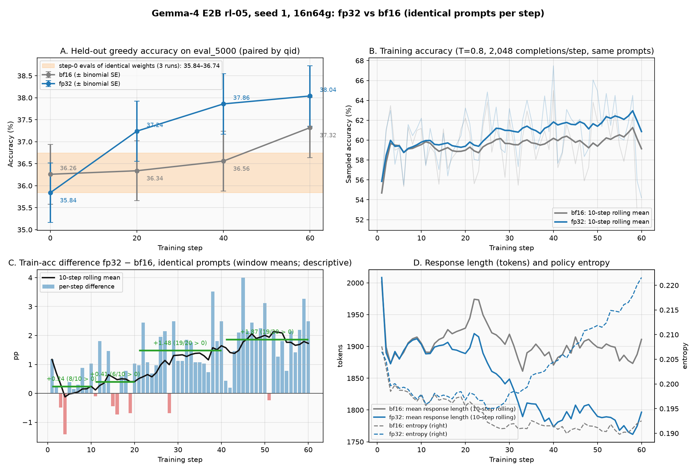

# Gemma-4: weak-learning / optimizer-update-precision investigation — results (PR #10)

Plan and checklist: [UPDATE_PRECISION_PLAN.md](UPDATE_PRECISION_PLAN.md). This file records measured results per plan item, including negative or inconclusive ones. Evidence lives in [`update_precision/`](update_precision/).

> [!IMPORTANT]
> **Status:** items 1–3 are complete. Item 4: the FP32 candidate is frozen (launcher sha256 `7d511735…`) and its 200-step seed 1 is running; single-variable optimization follows (§4).
>
> **What is established:** in the original recipe the optimizer holds BF16 parameters and BF16 Adam moments, and most of each AdamW update is lost when it is written back to the BF16 weights (item 2). Switching the whole optimizer path to FP32 (parameter storage, gradient storage and Adam moments), with nothing else changed, makes the model learn faster on identical training prompts over 60 steps, and its held-out accuracy rises at every checkpoint relative to its own step 0 (item 3). **What is not established:** the size of the held-out gain at the predeclared 200-step endpoint, or across seeds. The 60-step held-out difference between the two arms is in the same direction but small relative to eval noise.

## Summary

| Question | Finding | Evidence |
|---|---|---|
| Did PR #9 BF16 seed 1 improve held-out accuracy? | Step 0 → 200: **+0.54 pp**, question-paired bootstrap 95% **[−0.48, +1.48] pp**. Two greedy evals of **identical** step-0 weights differ by **+0.48 pp** (+305 / −281 questions, 288 / 5,000 identical outputs). The change is within eval nondeterminism. | §1.2, [`audit_seed1/audit.md`](update_precision/audit_seed1/audit.md) |
| Is the reward signal broken? | No defect found. 69.5% of GRPO groups have identical rewards (zero advantage), 27.3% have mixed correctness and carry 90.6% of the advantage mass; format-only groups carry 9.4% (16.4% in steps 1–20, 5.9% in steps 181–200). Dumped scores reproduce exactly on re-scoring. | §1.3–1.4 |
| What does the optimizer actually hold? | `torch.optim.AdamW` on FSDP1 flat parameters in **bf16**; grads, `exp_avg`, `exp_avg_sq` also **bf16**; no FP32 master copy. | §2.2 |
| Are updates retained? | **BF16:** 0.50% / 0.27% of elements change at steps 1 / 2; ‖applied‖/‖ideal‖ = **0.167 / 0.124**, cos(applied, ideal) = **0.107 / 0.090**. **FP32 control** (`model_dtype=fp32` only): ‖applied‖/‖ideal‖ = **1.0000**, cos = **1.0000**. | §2.3 |
| Which part loses the update? | **Write-back rounding.** On the same gradients, BF16 moments with FP32 write-back reproduce the intended update (cos 1.0000); FP32 moments with BF16 write-back lose as much as the real optimizer (‖·‖/‖ideal‖ 0.166 / 0.116). The changed set matches the round-to-nearest prediction (99.5% / 99.6%). Every parameter category is affected, including norms. | §2.3–2.4 |
| What does the rollout see? | Per step, about 0.5% of BF16 casts change in both runs; with an FP32 master the visible change accumulates (0.494% → 0.593% after two steps), with BF16 it does not (0.498% → 0.493%). | §2.4 |
| Does FP32 persistent precision learn faster (60 steps, seed 1, identical prompts)? | **Yes, on the training distribution:** training-accuracy gap FP32 − BF16 grows from +0.24 pp (steps 1–10) to **+1.87 pp (steps 41–60; FP32 ahead in 19 of 20 steps)**; format 99.8% vs 99.0%. **Held-out:** FP32 vs its own step 0 **+1.40 / +2.02 / +2.20 pp** at steps 20 / 40 / 60 (all intervals exclude 0). FP32 − BF16 is +0.90 / +1.30 / +0.72 pp; only step 40's interval excludes 0. | §3 |

## 1. Audit of existing evidence (plan item 1)

### 1.1 Reference preserved

The PR #9 run `gemma4_e2b_rl05_16n64g_s200_seed1_1021_1955` remains the original-recipe (BF16) reference. Its provenance — image digest, package versions, verl pin with pristine/managed file hashes, patch versions, launcher and reward hashes, model file hashes, data / eval / prompt-token fingerprints, and the resolved actor configuration — is in [`update_precision/reference_manifest.json`](update_precision/reference_manifest.json). All 16 pods are the ones that ran it (started 2026-10-20T09:21Z, no restarts). Seed 2 of this recipe was stopped at step 147; its evals at steps 0–140 are used only as a replicate below.

### 1.2 Eval pairing by question identity, and the eval noise floor

[`gemma4_learning_signal.py`](gemma4_learning_signal.py) checks every eval dump before pairing: 5,000 unique `qid`s (`extra_info.index`, the `val.parquet` row) per file, and the same `qid` set, input hash and ground-truth hash in all 11 checkpoints and in the replicate run. All comparisons below pair by `qid`; bootstrap intervals resample questions (2,000 resamples).

| Comparison | Acc A → B (%) | Δ (pp) | paired SE (pp) | bootstrap 95% (pp) | +gained / −lost | identical outputs |
|---|---|---:|---:|---|---|---:|
| seed 1 step 0 → step 200 (predeclared endpoint) | 36.26 → 36.80 | **+0.54** | 0.49 | **[−0.48, +1.48]** | +309 / −282 | 135 / 5000 |
| seed 1 vs seed-2 run, **step 0 (identical weights)** | 36.26 → 36.74 | **+0.48** | 0.48 | [−0.40, +1.40] | **+305 / −281** | **288 / 5000** |
| seed 1 step 0 → 60 / 120 / 180 | 36.26 → 37.32 / 37.50 / 37.34 | +1.06 / +1.24 / +1.08 | 0.48–0.49 | [+0.16, +1.96] / [+0.26, +2.16] / [+0.12, +2.04] | +317/−264, +333/−271, +315/−261 | 189 / 163 / 152 |
| seed 1 vs seed-2 run, steps 20–140 (different trajectories) | — | −0.62 … +0.12 | 0.46–0.49 | all intervals include 0 | ≈ +270 / −290 | 218–268 |

Reading:

- Batched greedy vLLM evaluation is **not** run-to-run deterministic here: identical weights give 288 / 5,000 identical outputs and ~290 flips in each direction. The same-run step-0 → step-200 comparison has the same number of flips (+309 / −282), so gained / lost counts mostly measure eval nondeterminism, not learning.
- The predeclared endpoint (step 200) is not distinguishable from zero. Three intermediate checkpoints have intervals that exclude zero, but they are 3 of 10 unadjusted comparisons, and the identical-weights step-0 difference alone is +0.48 pp. At most a gain of about 1 pp is compatible with these data.
- Questions never solved at any of the 11 checkpoints: 45.0%; always solved: 23.0%; sometimes: 32.0%.

### 1.3 Training groups and reward signal

All 200 training dumps have 256 groups × 8 completions per step (51,200 groups); no group mixes inputs or ground truths. Advantages are recomputed as verl's GRPO (`(s − mean) / (std + 1e-6)`, unbiased std).

| Window | Train acc (T=0.8) | mean group std (score / acc) | all-same correct | all-same wrong | format-only (correct / wrong) | correctness-mixed | Σ\|A\| share: format-only | Σ\|A\| share: correctness-mixed | length-weighted share: format-only |
|---|---:|---|---:|---:|---|---:|---:|---:|---:|
| steps 1–20 | 59.27% | 0.124 / 0.121 | 44.1% | 22.1% | 1.3% / 4.9% | **27.7%** | 16.4% | 83.6% | 19.7% |
| steps 91–110 | 59.16% | 0.121 / 0.120 | 45.3% | 24.6% | 0.5% / 2.5% | **27.1%** | 8.6% | 91.4% | 12.1% |
| steps 181–200 | 61.31% | 0.119 / 0.118 | 47.8% | 23.4% | 0.3% / 1.7% | **26.9%** | 5.9% | 94.1% | 7.9% |
| all | 59.91% | 0.121 / 0.120 | 45.8% | 23.7% | 0.6% / 2.7% | **27.3%** | 9.4% | 90.6% | 12.4% |

Reading: about 70% of prompts give no gradient (all 8 completions score the same), so the effective batch is about 30% of the nominal 256 prompts. Because GRPO normalizes by the group std, a group whose scores differ only by the 0.1 format credit gets advantages as large as a correctness group; such groups carried 16% of the advantage mass early and 6% late. This dilutes the correctness signal but does not remove it: correctness-mixed groups (~27% of prompts) carry 84–94% of the advantage mass throughout. The training accuracy rose only from 59.3% to 61.3% over 200 steps.

### 1.4 Grading audit

| Source | wrong rows | audited | no answer extracted | numerically equal after normalization | gold contained in guess | both numeric, different | other (symbolic / text) | re-scored now correct |
|---|---:|---:|---:|---:|---:|---:|---:|---:|
| train step 1 | 928 | 400 | 6 | 1 | 9 | 240 | 142 | 0 / 100 |
| train step 100 | 893 | 400 | 2 | 0 | 18 | 220 | 160 | 0 / 100 |
| train step 200 | 722 | 400 | 2 | 1 | 33 | 234 | 130 | 0 / 100 |
| eval step 0 | 3187 | 400 | 35 | 1 | 17 | 205 | 142 | 0 / 100 |
| eval step 200 | 3160 | 400 | 21 | 0 | 21 | 221 | 137 | 0 / 100 |
| eval correct at step 0 → wrong at step 200 | 282 | 282 | 22 | 0 | 23 | 166 | 71 | 0 / 100 |

Reading:

- Re-scoring with `compute_score` reproduces every dumped label checked (0 / 600 changed), so grading is deterministic.
- Most wrong answers are numerically different from the gold (e.g. `-3` vs `3`, `931` vs `31`). "Numerically equal" cases are not false negatives on inspection (e.g. `2` vs gold `(0, 2)`).
- A small number of likely false negatives come from the MaxText-verbatim normalization: `8+sqrt(2)` is rewritten to `8+\sqrt{(}2)` and then fails to parse; `0.7137\overline{7137}` vs `0.\overline{7137}`; `33.33` vs `33.33\%`. They are a small fraction of wrong answers and affect GPU and TPU identically if the same grader is used.
- "No answer extracted" and many "other" cases are degenerate generations (repeated sentences or digit runs up to the length cap), visible in both the step-0 and the step-200 samples.
- Correct → wrong transitions between step 0 and step 200 show the same mix (mostly genuinely different numbers, some degenerate generations) and no scoring artifacts; with the replicate above, they are consistent with eval nondeterminism.

### 1.5 Presentation corrections to the PR #9 docs

Applied in this PR to [EVAL_PROTOCOL.md](EVAL_PROTOCOL.md) §5 and [README.md](README.md) §4:

- Format compliance went 93.94% → 96.70% but **not monotonically** (dips at steps 40→60, 60→80, 140→160).
- The attribution of ~300 flips per direction to questions "near the greedy decision boundary" is withdrawn (no logit evidence; the identical-weights replicate shows flips of the same size).
- "Steady plateau" / "rose" wording replaced by the predeclared endpoint with its question-paired interval; intermediate checkpoints are reported as trajectory only.
- Timing outliers are annotated: step 1 (111.1 s, compile) and step 182 (**397.4 s**, of which rollout 370.8 s); the diagnostics figure now marks step 182, which is off its axis.

## 2. Effective-update probe (plan item 2)

### 2.1 Method

[`gemma4_optim_probe/`](gemma4_optim_probe/__init__.py) is installed as a Ray `worker_process_setup_hook` through the job `runtime_env` (`py_modules` ships the directory), so it runs through the unchanged frozen launcher, node prep and RoPE guard, and changes no verl file. It is a no-op unless `VERL_OPTIM_PROBE_DIR` is set, and it only reads tensors. For the first two `torch.optim.AdamW.step()` calls on every rank it:

1. records the dtypes of the optimizer-owned parameters (FSDP1 flat-parameter shards), their gradients and the Adam state;
2. snapshots each parameter before the step and subtracts in FP32 after it (`applied`);
3. runs an optimizer-only counterfactual **on the same captured (post-clip) gradients**, from the same starting values cast to FP32 and fresh moments, with the optimizer's own lr / betas / eps / weight decay and step count: the FP32 AdamW update (`ideal`), and (v2) the update with FP32 moments but write-back rounded to the parameter dtype (`fb`) and the update from the optimizer's own moments without write-back rounding (`bf`);
4. counts total / nonzero-gradient / changed elements and the elements predicted to change by round-to-nearest (|ideal| > half an ulp of the stored value), and (v2) the elements whose BF16 cast — what the rollout engine receives — changed, per original parameter.

The CPU self-test ([`test_gemma4_optim_probe.py`](test_gemma4_optim_probe.py), [output](update_precision/probe/selftest.txt)) checks the probe on a toy model: FP32 parameters change 100% with applied = ideal; BF16 parameters match the round-to-nearest prediction to within ties.

Runs: `NNODES=16 TOTAL_STEPS=2` through `run_gemma4_e2b_rl05_parity.sh` with seed 1 (the same first batches as PR #9 seed 1), once as-is (BF16) and once with the single override `++actor_rollout_ref.actor.fsdp_config.model_dtype=fp32`. Both runs passed the RoPE guard on 64 / 64 ranks ([BF16](update_precision/probe/v1_bf16_guard_check.txt), [FP32](update_precision/probe/v1_fp32_guard_check.txt)); `k3_kl` = 0.00071 / 0.00072 in both; peak reserved memory 57–61 GB in both; step 2 took 61.0 s (BF16) and 64.2 s (FP32).

### 2.2 Runtime dtypes and settings (all 64 ranks)

| | BF16 (original recipe) | FP32 control |
|---|---|---|
| Optimizer | `torch.optim.AdamW`, lr 1e-6 (constant, no warmup), betas (0.9, 0.999), eps 1e-8, weight decay 0.01, `foreach=None`, `fused=None` | same |
| Elements held by the optimizer | 5,104,297,536 | 5,104,297,536 |
| param / grad / `exp_avg` / `exp_avg_sq` | **bf16 / bf16 / bf16 / bf16** | fp32 / fp32 / fp32 / fp32 |
| FP32 master copy | **none** (FSDP1 flat params are bf16 after `module.to(bfloat16)`; the optimizer state holds only the moments) | the parameters themselves |
| Gradient norm, steps 1 / 2 (pre-clip = post-clip; clip 1.0 not reached) | 0.742 / 0.501 | 0.220 / 0.546 |

The two runs sample different rollouts, so their gradients differ; each run compares its applied update with the ideal update for its own gradients.

### 2.3 v1 results: applied vs ideal update

| Run | Step | elements with grad | nonzero grad | **changed** | changed / nonzero grad | predicted to change (round-to-nearest) | **‖applied‖ / ‖ideal‖** | **cos(applied, ideal)** | ‖Δw‖/‖w‖ applied | ‖Δw‖/‖w‖ ideal | mean \|Δw\| applied / ideal |
|---|---:|---:|---:|---:|---:|---:|---:|---:|---:|---:|---:|
| BF16 | 1 | 4,634,769,472 | 50.50% | **0.504%** | 0.998% | 0.503% | **0.1671** | **0.1074** | 6.52e-7 | 3.90e-6 | 6.73e-9 / 3.85e-7 |
| BF16 | 2 | 4,634,769,472 | 50.38% | **0.272%** | 0.540% | 0.271% | **0.1237** | **0.0900** | 3.50e-7 | 2.83e-6 | 2.57e-9 / 2.55e-7 |
| FP32 | 1 | 4,634,769,472 | 50.50% | 42.400% | 83.955% | 42.405% | **1.0000** | **1.0000** | 3.87e-6 | 3.87e-6 | 3.81e-7 / 3.82e-7 |
| FP32 | 2 | 4,634,769,472 | 50.49% | 42.757% | 84.691% | 42.762% | **1.0000** | **1.0000** | 2.86e-6 | 2.86e-6 | 2.58e-7 / 2.58e-7 |

Reading:

- In BF16, about 1 in 100–200 elements with a nonzero gradient moves per step, the applied update has 12–17% of the intended norm, and its direction is nearly orthogonal to the intended one (cos ≈ 0.1). The mean per-element movement is 1–2% of the intended one.
- The measured changed set agrees with the round-to-nearest prediction (99.5% of changed elements were predicted, 99.6% of predicted elements changed): an AdamW step of ~1e-6 survives only on weights with |w| below about 2⁻¹¹ ≈ 4.9e-4, where it is rounded up to one bf16 ulp.
- With FP32 persistent weights and moments, the applied update equals the intended one. Elements that do not change in FP32 (~16% of those with nonzero gradient) have intended updates below FP32 resolution (gradients far below eps).
- About half of the elements have exactly zero gradient in a step (mostly embedding rows of tokens absent from the batch); this is the same in both runs.

### 2.4 v2: moments vs write-back, per-parameter categories, rollout visibility

Second pair of 2-step runs with probe v2 (`gemma4_e2b_rl05_16n64g_optprobe_bf16v2_1022_1720`, `gemma4_e2b_rl05_16n64g_optprobe_fp32v2_1022_1733`; [BF16 summary](update_precision/probe/v2_bf16_summary.md), [FP32 summary](update_precision/probe/v2_fp32_summary.md); RoPE guard PASS on 64 / 64 ranks in both). The BF16 v2 run reproduces v1 (changed 0.498% / 0.266%, ‖applied‖/‖ideal‖ 0.166 / 0.117, cos 0.107 / 0.088; gradient norm 0.81 / 1.00, so clipping engaged at step 2).

**2×2 optimizer-only counterfactual on the same gradients (BF16 run).** Moments and write-back precision are varied separately; `ideal` = FP32 moments, FP32 write-back.

| Step | fb: FP32 moments + BF16 write-back (‖·‖/‖ideal‖, cos, changed) | bf: BF16 moments + FP32 write-back (‖·‖/‖ideal‖, cos) | applied: BF16 moments + BF16 write-back (‖·‖/‖ideal‖, cos, changed) | cos(applied, fb) |
|---:|---|---|---|---:|
| 1 | 0.1663, 0.1070, 0.499% | 1.0001, 1.0000 | 0.1660, 0.1069, 0.498% | 0.9947 |
| 2 | 0.1163, 0.0878, 0.266% | 0.9998, 1.0000 | 0.1165, 0.0878, 0.266% | 0.9876 |

At steps 1–2 the loss comes from write-back rounding: BF16 Adam-moment arithmetic with FP32 write-back reproduces the intended update (cos 1.0000), while FP32 moments with BF16 write-back lose as much as the real BF16 optimizer. (Moment precision could still matter over many steps, see §2.5.)

**Per original-parameter category (BF16 run, step 1 / step 2).** Parameter names inside FSDP1 units are layer-relative, so same-named tensors of all layers are summed.

| Category | elements | changed (step 1 / 2) | \|w\| < 2⁻¹¹ | ‖applied‖/‖ideal‖ (1 / 2) | cos (1 / 2) | ‖Δw‖/‖w‖ applied vs ideal (step 1) |
|---|---:|---|---:|---|---|---|
| attention (q/k/v/o) | 278,396,928 | 1.269% / 0.678% | 1.51% | 0.170 / 0.121 | 0.109 / 0.090 | 4.9e-6 vs 2.9e-5 |
| MLP | 1,557,135,360 | 1.173% / 0.621% | 1.41% | 0.163 / 0.114 | 0.105 / 0.086 | 4.9e-6 vs 3.0e-5 |
| norm weights | 286,112 | 1.816% / 0.576% | 1.87% | 0.242 / 0.150 | 0.134 / 0.090 | 1.3e-8 vs 5.2e-8 |
| token embedding | 406,192,128 | 0.034% / 0.024% | 1.34% | 0.143 / 0.103 | 0.095 / 0.078 | 7.6e-7 vs 5.3e-6 |
| per-layer embedding / projection | 2,390,097,920 | 0.048% / 0.028% | 0.67% | 0.223 / 0.168 | 0.146 / 0.123 | 4.7e-7 vs 2.1e-6 |
| other (zero gradient; weight decay only) | 2,660,992 | 0% / 0% | 1.57% | 0 / 0 | — | 0 vs 1.0e-8 |

Every category, including the small norm tensors, keeps only 12–24% of the intended update norm. The changed fraction per category tracks the share of weights small enough for a ~1e-6 step to survive.

**Rollout visibility (BF16 weights the vLLM rollout receives).**

| Run | step 1: BF16 cast changed | step 2: BF16 cast changed | cumulative after 2 steps | persistent weights changed (step 1 / 2) |
|---|---:|---:|---:|---|
| BF16 (rollout weights = trainer weights) | 0.498% | 0.266% | 0.493% | 0.498% / 0.266% |
| FP32 master | 0.494% | 0.434% | **0.593%** | 42.38% / 42.76% |

With FP32 master weights, nearly every element with a gradient changes in the persistent weights, but only about 0.5% of BF16 casts change per step: a BF16 value flips only once the accumulated FP32 change crosses a BF16 rounding boundary. The difference is accumulation. In the FP32 run the cumulative visible fraction grows (0.494% → 0.593% after two steps) and the cast always stays within half a BF16 ulp of the full-precision trajectory. In the BF16 run sub-ulp updates are discarded, so the visible change does not accumulate (0.498% → 0.493%). Per category (FP32 run, cumulative after two steps): attention 1.51%, MLP 1.40%, norm 1.67%, token embedding 0.05%, per-layer embedding 0.06%.

FP32 persistent weights apply the intended update for attention, MLP and embeddings exactly (‖applied‖/‖ideal‖ = 1.0000). Norm weights are the exception: ‖applied‖/‖ideal‖ = 0.974 / 0.960 and 95% / 90% of norm elements changed. Their intended relative update is about 5e-8, which for large-valued norm weights is close to half an FP32 ulp. They are 0.29M of 5.1B elements.

### 2.5 What this does and does not establish

- Established: the original recipe's optimizer has no FP32 master copy, and BF16 write-back discards most of each AdamW update at lr 1e-6 (measured on all 64 ranks, two steps, real gradients).
- Not established: that this explains the held-out result. Steps 1–2 do not show long-run behavior (for example, with BF16 moments the β₂ = 0.999 decay of `exp_avg_sq` is itself below BF16 resolution, which only matters over many steps), and a probe does not measure learning. Item 3 measures the end-to-end effect.

## 3. Controlled precision comparison (plan item 3) — complete (60 steps, seed 1)

- **Arm FP32:** `gemma4_e2b_rl05_16n64g_s60_fp32ab_seed1_1022_1744` (2026-10-22T17:44Z–19:53Z): the frozen accuracy wrapper and launcher (`run_gemma4_e2b_rl05_accuracy_baseline.sh` sha256 `2a37aad5…`, `run_gemma4_e2b_rl05_parity.sh` sha256 `8646c173…`), `SEED=1`, `NNODES=16`, `TOTAL_STEPS=60`, eval at steps 0 / 20 / 40 / 60 on `eval_5000`. Single override: `++actor_rollout_ref.actor.fsdp_config.model_dtype=fp32` (FP32 persistent weights and moments, verified at runtime in §2.2). Compute stays BF16 through FSDP mixed precision, and rollout weights are BF16 casts. No probe hook. Exit 0, 60 / 60 steps; RoPE guard PASS on 64 / 64 ranks ([guard check](update_precision/ab_fp32_vs_bf16/guard_check.txt)); driver log [`logs/gemma4_e2b_rl05_16n64g_s60_fp32ab_seed1_1022_1744.log`](logs/gemma4_e2b_rl05_16n64g_s60_fp32ab_seed1_1022_1744.log).
- **Arm BF16:** the preserved PR #9 seed 1, steps 0–60.
- **Kept fixed:** initial weights, data order (the same 256 prompt `qid`s verified at every one of the 60 steps), prompts and reward, batch size, GRPO objective with PPO clipping and global token-mean loss, LR schedule, clipping, eval protocol.
- **Predeclared comparisons** (written before the run finished): (a) training accuracy on identical prompts, paired by step; (b) held-out accuracy at steps 20 / 40 / 60, paired by `qid`, read against the identical-weights noise floor; (c) gradient norms, `k3_kl`, entropy, response length, step time.
- Output of [`gemma4_ab_compare.py`](gemma4_ab_compare.py): [`ab_fp32_vs_bf16_s60.md`](update_precision/ab_fp32_vs_bf16/ab_fp32_vs_bf16_s60.md) / [`.json`](update_precision/ab_fp32_vs_bf16/ab_fp32_vs_bf16_s60.json).



### 3.1 (a) Training accuracy on identical prompts

| Steps | BF16 train acc (%) | FP32 train acc (%) | FP32 − BF16 mean (pp) | SD of per-step difference (pp) | steps with FP32 ahead | format BF16 / FP32 (%) |
|---|---:|---:|---:|---:|---:|---|
| 1–10 | 59.56 | 59.80 | +0.24 | 0.76 | 8 / 10 | 97.72 / 98.39 |
| 11–20 | 58.98 | 59.38 | +0.41 | 0.89 | 6 / 10 | 98.19 / 99.31 |
| 21–40 | 59.92 | 61.40 | **+1.48** | 0.90 | 19 / 20 | 98.66 / 99.76 |
| 41–60 | 59.26 | 61.13 | **+1.87** | 1.04 | 19 / 20 | 98.98 / 99.78 |
| 1–60 | 59.48 | 60.71 | **+1.22** | 1.12 | 52 / 60 | 98.53 / 99.46 |

Each step trains on the same 256 prompts in both arms (validated: 2,048 rows = 256 groups × 8, one input and one ground truth per group, identical `qid` → input / ground truth in both arms, steps 1–60 complete), so per-step differences remove prompt difficulty. The window statistics are descriptive: consecutive steps of the same two runs are not independent replicates (each run's state carries over), so no standard error or significance is attached to them.

### 3.2 (b) Held-out `eval_5000` (greedy, paired by `qid`)

| Step | BF16 (%) | FP32 (%) | FP32 − BF16 (pp) | bootstrap 95% | +gained / −lost | BF16 vs own step 0 | FP32 vs own step 0 (95%) | identical outputs |
|---:|---:|---:|---:|---|---|---:|---|---:|
| 0 (identical weights) | 36.26 | 35.84 | −0.42 | [−1.32, +0.46] | +258 / −279 | — | — | 279 / 5000 |
| 20 | 36.34 | 37.24 | +0.90 | [−0.06, +1.90] | +335 / −290 | +0.08 | **+1.40** [+0.48, +2.44] | 128 / 5000 |
| 40 | 36.56 | 37.86 | **+1.30** | [+0.26, +2.30] | +353 / −288 | +0.30 | **+2.02** [+1.04, +3.02] | 36 / 5000 |
| 60 | 37.32 | 38.04 | +0.72 | [−0.24, +1.72] | +344 / −308 | +1.06 | **+2.20** [+1.22, +3.20] | 29 / 5000 |

Noise floor: the three step-0 evals of identical base weights (BF16 seed-1 run, BF16 seed-2 run, FP32 run) scored 36.26%, 36.74% and 35.84%: a 0.90 pp range from eval nondeterminism alone. Against their mean (36.28%), FP32 is +0.96 / +1.58 / +1.76 pp at steps 20 / 40 / 60 and BF16 is +0.06 / +0.28 / +1.04 pp.

### 3.3 (c) Diagnostics (window medians, BF16 → FP32)

| Steps | `k3_kl` | `grad_norm` | entropy | mean response length (tokens) | train reward | step time (s) |
|---|---|---|---|---|---|---|
| 1–20 | 0.000697 → 0.000694 | 0.259 → 0.241 | 0.196 → 0.197 | 1937 → 1915 | 0.691 → 0.699 | 69.2 → 64.9 |
| 21–40 | 0.000688 → 0.000706 | 0.243 → 0.340 | 0.193 → 0.201 | 1887 → 1815 | 0.700 → 0.712 | 66.3 → 67.1 |
| 41–60 | 0.000686 → 0.000732 | 0.312 → 0.218 | 0.193 → 0.216 | 1917 → 1806 | 0.699 → 0.715 | 68.8 → 67.8 |

### 3.4 Reading

- **Precision is supported as a cause of the weak learning.** With only the optimizer-path precision changed, the FP32 arm pulls ahead on identical training prompts, and the gap grows with training: +0.24 pp in steps 1–10, +1.48 pp in steps 21–40 and +1.87 pp in steps 41–60, with FP32 ahead in 19 of 20 steps in each of the last two windows. This is one run per arm, so it is strong directional evidence rather than a significance test. It is consistent with item 2: the BF16 arm keeps 12–17% of each intended update, the FP32 arm all of it.
- **Attribution boundary.** The A/B switches the whole optimizer path at once: parameter storage, gradient storage and Adam moments all go from BF16 to FP32. It shows that this path as a whole matters; it does not by itself separate write-back rounding from moment precision. That separation comes from the same-gradient probe in §2.4, where BF16 moments with FP32 write-back reproduced the intended update at steps 1–2.
- **Held-out moves in the same direction, with limited resolution.** FP32 improves at every checkpoint relative to its own step 0 (+1.40 / +2.02 / +2.20 pp; all intervals exclude zero) and relative to the mean of the three identical-weights step-0 evals (+0.96 / +1.58 / +1.76 pp). The direct FP32 − BF16 difference is +0.90 / +1.30 / +0.72 pp; only step 40's interval excludes zero. BF16's step-60 value (37.32%) is inside the band it occupied over steps 60–200 (36.68–37.50%).
- **Behavior to watch in a longer run:** FP32 policy entropy rises after step 30 (window median 0.197 → 0.216) while BF16 stays near 0.193; FP32 responses get about 100 tokens shorter; `k3_kl` stays at BF16-noise level but edges up (0.000694 → 0.000732). Step time and memory are unchanged.
- **Limitations:** one seed, 60 steps, one eval pass per checkpoint. Three greedy evals of identical step-0 weights spanned 0.90 pp; three samples show that the eval is nondeterministic but do not establish a per-eval error bound. The magnitude of the held-out gain at step 200 is unknown; this comparison establishes early learning behavior, not convergence.

## 4. Toward an optimized recipe (plan item 4, revised order)

Review of `ab70122` approved freezing the FP32 configuration as the current candidate. FP32 fixes update precision; it is not yet an optimized recipe. The order is now:

1. **FP32 seed 1, full 200 steps — running.** Launcher frozen in commit `203b40f`: `run_gemma4_e2b_rl05_parity.sh` sha256 `7d511735c00a1c883645ba4fd02fc802bbc535f51a7f36229768f24d29969c2a`. The only change from the PR #9 recipe is `actor.fsdp_config.model_dtype=fp32`; the accuracy wrapper (sha256 `2a37aad5…`) and eval protocol are unchanged. Run `gemma4_e2b_rl05fp32_16n64g_s200_seed1_1022_2019`, started 2026-10-22T20:19Z, `16n64g`, eval at steps 0, 20, …, 200. This is a new cohort. The 60-step A/B run is not reused as seed 1 because it ran on the pre-freeze launcher with an override.
2. **Single-variable optimization from that curve.** Compare one change at a time against the FP32 seed-1 curve under the fixed eval, on accuracy vs steps and accuracy vs wall time. Seed 1 is used for screening. The levers are chosen after step 1. Each must be reproducible on the TPU side, because the customer gate compares identical recipes. Candidates suggested by the evidence so far:
   - prompt format: the current prompt is double-wrapped (MaxText's Gemma-3-style `TEMPLATE` inside the user turn, then the Gemma-4 chat template; [EVAL_PROTOCOL.md §2](EVAL_PROTOCOL.md)). A single-wrapped prompt needs a new eval prompt fixture and the same change on TPU;
   - learning rate;
   - updates per rollout (`ppo_mini_batch_size`);
   - group size / batch shape, given that ~70% of groups have zero advantage;
   - response cap, for wall time;
   - a systems-only item: in the PR #9 run, wall time per step (~112 s) exceeded `timing_s/step` (~67 s), because metrics and TensorBoard writes to GCS Fuse ran outside the step timer.
3. **Select and freeze** the recipe that balances accuracy and training efficiency. Final conclusions, and the GPU reference for the TPU gate, come from multi-seed runs of that frozen recipe.

## Reproduction

```bash
# Ray head pod
source /workspace/setup_env.sh
D=/workspace/meta-RL/verl/examples/grpo_trainer/my_scripts_GKE_gemma4
# item 1: audit (CPU)
python3 $D/gemma4_learning_signal.py --run-dir /workspace/meta-RL/logs/gemma4_eval/gemma4_e2b_rl05_16n64g_s200_seed1_1021_1955 \
  --replicate-run /workspace/meta-RL/logs/gemma4_eval/gemma4_e2b_rl05_16n64g_s200_seed2_1022_0301 --out-md audit.md --out-json audit.json
# item 2: 2-step probe (add ++actor_rollout_ref.actor.fsdp_config.model_dtype=fp32 for the FP32 control)
NNODES=16 TOTAL_STEPS=2 EXPERIMENT_NAME=<exp> bash $D/run_gemma4_e2b_rl05_parity.sh \
  data.seed=1 actor_rollout_ref.rollout.seed=1 actor_rollout_ref.actor.data_loader_seed=1 actor_rollout_ref.actor.fsdp_config.seed=1 \
  "++ray_kwargs.ray_init.runtime_env.py_modules=[\"$D/gemma4_optim_probe\"]" \
  ++ray_kwargs.ray_init.runtime_env.worker_process_setup_hook=gemma4_optim_probe.install \
  ++ray_kwargs.ray_init.runtime_env.env_vars.VERL_OPTIM_PROBE_DIR=/workspace/meta-RL/logs/gemma4_optim_probe/<exp> \
  '++ray_kwargs.ray_init.runtime_env.env_vars.VERL_OPTIM_PROBE_STEPS="2"'
python3 $D/gemma4_optim_probe_report.py --probe-dir /workspace/meta-RL/logs/gemma4_optim_probe/<exp> --world 64 --label <label>
# item 3: FP32 arm, then the paired comparison
SEED=1 NNODES=16 TOTAL_STEPS=60 EXPERIMENT_NAME=<exp> bash $D/run_gemma4_e2b_rl05_accuracy_baseline.sh \
  ++actor_rollout_ref.actor.fsdp_config.model_dtype=fp32
E=/workspace/meta-RL/logs/gemma4_eval; L=/workspace/meta-RL/logs
python3 $D/gemma4_ab_compare.py --a bf16=$E/gemma4_e2b_rl05_16n64g_s200_seed1_1021_1955 --a-log $L/gemma4_e2b_rl05_16n64g_s200_seed1_1021_1955.log \
  --b fp32=$E/<exp> --b-log $L/<exp>.log --max-step 60 --replicate bf16_seed2run=$E/gemma4_e2b_rl05_16n64g_s200_seed2_1022_0301 \
  --out-md ab.md --out-json ab.json --plot ab.png
```
